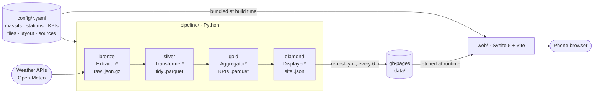
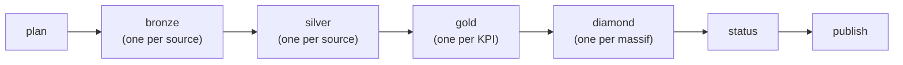

<div align="center">


# Bluebird

**Ski-condition odds for French ski resorts, refreshed every 6 hours from ensemble weather forecasts.**

[](https://github.com/oreLINK/bluebird/actions/workflows/ci.yml)
[](https://github.com/oreLINK/bluebird/actions/workflows/refresh.yml)
[](https://github.com/oreLINK/bluebird/actions/workflows/deploy.yml)
<br>


[Live site](https://orelink.github.io/bluebird/) ·
[Product overview](PROJECT.md) ·
[Tiles](TILES.md) ·
[AI briefing](CONTEXT.md) ·
[Agent rules](AGENTS.md)

</div>

---

Bluebird is a **static, mobile-first website** backed by a **Python data
pipeline**. Four times a day, the pipeline downloads ensemble weather
forecasts (91 scenarios from ECMWF and DWD), turns them into probabilities for
every resort and time slot, and publishes small JSON files that the site
ranks like a sports-betting page. Everything, hosting and storage included,
runs on GitHub: no server, no database, no paid service.

This README is written for **developers of the project**. Site users should
read [PROJECT.md](PROJECT.md); AI agents read [AGENTS.md](AGENTS.md) and
[CONTEXT.md](CONTEXT.md).

## Highlights

- **19 live indicators** in six categories (snow, snow quality, sky, comfort,
  getting there, safety), each computed for today and tomorrow, per time slot
  (morning, lunchtime, afternoon, evening, night) and for the whole day.
- **Rewinds**: historical indicators that review a closed season from
  archived forecasts. The first one, *Rewind 25/26* (1 December 2025 – 1 May
  2026, Pyrenees), ranks the resorts on season snowfall, longest snowfall,
  snow on the slopes and off-piste, ideal snow cover days and white days.
- **18 Pyrenean resorts**, navigated by place (massif → département →
  linked ski area) and by filter levels (category → sub-category → day →
  time slot).
- **Configuration first**: massifs, stations, KPIs, labels, tiles and layout
  live in YAML; most changes need no code.
- **One typed contract** between Python and TypeScript, generated from
  pydantic models and checked in CI.
- **Resilient refreshes**: one CI job per source, KPI and massif, with a
  fallback to the last valid values and a public service-status page.
- **Accessible and trilingual**: French (default), English and Spanish, light
  and dark mode, reduced motion and transparency respected.

## Table of contents

- [Quick start](#quick-start)
- [Architecture](#architecture)
- [Tech stack](#tech-stack)
- [Repository layout](#repository-layout)
- [Commands](#commands)
- [Data model](#data-model)
- [Configuration reference](#configuration-reference)
- [Extending Bluebird](#extending-bluebird)
- [Frontend](#frontend)
- [Tiles on the site](#tiles-on-the-site)
- [Testing and quality](#testing-and-quality)
- [CI/CD and deployment](#cicd-and-deployment)
- [Data sources, limits and licences](#data-sources-limits-and-licences)
- [Troubleshooting](#troubleshooting)
- [Roadmap](#roadmap)
- [Contributing](#contributing)
- [License](#license)

---

## Quick start

### Prerequisites

| Tool | Version | Used for |
|---|---|---|
| [uv](https://docs.astral.sh/uv/) | latest | Python environment (installs Python 3.12 itself) |
| Node.js + npm | 22 | Website |
| [GitHub CLI](https://cli.github.com/) | latest | One-time GitHub setup only |

> [!WARNING]
> **Synced folders (iCloud Drive, Dropbox).** Do not keep the Python
> virtualenv in a synced folder. iCloud flags files in `.venv` as hidden and
> Python 3.13+ silently ignores hidden `.pth` files, which breaks the
> editable install (`ModuleNotFoundError: bluebird_pipeline`). Clone outside
> iCloud, or point uv elsewhere:
> `export UV_PROJECT_ENVIRONMENT="$HOME/.venvs/bluebird"`.
> `node_modules` also syncs thousands of files; prefer a non-synced clone.

### Run the pipeline

```bash
cd pipeline
uv sync                      # create the environment
uv run bluebird validate     # check config/ and plugins
uv run bluebird run          # fetch live data, write data/{bronze,silver,gold,diamond}
uv run pytest                # tests (no network)
```

A live run takes a few seconds (one grouped request per source). Output goes
to `<repo>/data/`, which is git-ignored.

### Run the website

```bash
cd web
npm ci
npm run dev                  # http://localhost:5173, served from the demo files in web/public/data
```

To see your own pipeline output, copy it over the demo files with
`cp -R ../data/diamond public/data/`. Do not commit the result; rebuild the
demo with `uv run bluebird demo`.

---

## Architecture



| Principle | What it means |
|---|---|
| **Static site** | No server, no database: the pipeline writes JSON files, the site reads them. |
| **Medallion layers** | Each layer is a Python sub-package with one abstract base class and one plugin file per implementation. A plugin registers itself with a decorator, so a new source or KPI is a new file. |
| **Configuration first** | Massifs, stations, KPI parameters and labels, tiles and their order live in YAML. |
| **One contract** | The diamond JSON shape is defined once as pydantic models, exported as JSON Schema and turned into TypeScript types. CI fails when the two sides drift. |
| **Few API calls** | Each source is fetched with one grouped request per refresh (every station and elevation band at once), four times a day. |

## Tech stack

| Area | Technology |
|---|---|
| Pipeline | Python 3.12, uv, pydantic, polars, httpx, Parquet (zstd) |
| Website | Svelte 5 (runes), TypeScript 6, Vite, `@rollup/plugin-yaml`; no UI framework (≈ 32 KB of gzipped JavaScript) |
| Fonts | Sora (text, titles, values) and Barlow Semi Condensed ExtraBold Italic (logo only), OFL, self-hosted with `@fontsource` |
| Quality | ruff, pytest, svelte-check, Vitest, actionlint |
| CI/CD | GitHub Actions; site and data published on GitHub Pages (`gh-pages`) |

## Repository layout

<details>
<summary><strong>Show the tree</strong></summary>

```
bluebird/
├── README.md                  # developers (this file)
├── PROJECT.md                 # site users: purpose, features, roadmap, limits
├── CONTEXT.md                 # AI agents: architecture, invariants, recipes, pitfalls
├── AGENTS.md                  # AI agents: mandatory rules for every prompt
├── TILES.md                   # tile axes with pictures + inventory of every tile
├── CLAUDE.md                  # imports AGENTS.md + CONTEXT.md for Claude Code
├── docs/tiles/                # render.mjs → mockups of TILES.md (generated SVGs)
├── config/                    # human-edited configuration (single source of truth)
│   ├── massifs.yaml
│   ├── stations/<massif>.yaml
│   ├── kpis.yaml
│   ├── filters.yaml
│   ├── tiles.yaml
│   ├── layout.yaml
│   ├── sources.yaml
│   ├── periods.yaml           # time slots of the ski day (morning, evening…) and their labels
│   ├── pages.yaml             # footer + full-window pages (about, service status, legal notice, privacy)
│   ├── rewinds.yaml           # Rewinds: closed seasons and their historical KPIs
│   ├── reference/<dataset>/<massif>.geojson  # fetched once a season (`bluebird reference`)
│   ├── rewind/<id>/<massif>.hourly.parquet, .json  # GENERATED by `bluebird rewind`, committed
│   └── schemas/*.schema.json  # GENERATED by `bluebird schemas`
├── pipeline/                  # Python package `bluebird_pipeline`
│   ├── pyproject.toml  uv.lock  .python-version
│   ├── src/bluebird_pipeline/
│   │   ├── cli.py             # `bluebird` command
│   │   ├── config.py          # pydantic models of every YAML file + cross-checks
│   │   ├── registry.py        # plugin registry + autodiscovery
│   │   ├── context.py         # RunContext: config, storage, dates, silver access
│   │   ├── runner.py          # runs the layers in order, isolates failures, gold fallback
│   │   ├── report.py          # step reports (ok / partial / stale / down) of each unit
│   │   ├── checks.py          # config ↔ plugin consistency checks
│   │   ├── schemas.py         # JSON Schema export
│   │   ├── reference.py       # reference data: refresh, committed files, loading
│   │   ├── rewind.py          # Rewinds: season archive, historical KPIs, committed files
│   │   ├── geo.py             # distances and offsets on [lon, lat] points
│   │   ├── demo.py            # synthetic demo data for the frontend
│   │   ├── storage/           # Storage interface, LocalStorage, key conventions
│   │   ├── bronze/            # base.py + extractor_*.py
│   │   ├── silver/            # base.py + transformer_*.py
│   │   ├── gold/              # base.py + aggregator_*.py
│   │   └── diamond/           # base.py + models.py + displayer_*.py + _status.py (status.json)
│   └── tests/                 # mirrors the layer folders
├── web/                       # Vite + Svelte 5 + TypeScript
│   ├── src/
│   │   ├── App.svelte  main.ts
│   │   ├── lib/               # config, data loading, periods, status, i18n, formatting
│   │   │   └── generated/     # GENERATED TypeScript types (npm run gen:types)
│   │   ├── tiles/             # registry, tileModel, TileFull, TileBanner, TileCompact, OddsRow…
│   │   ├── components/        # Logo, LogoMark, AppHeader, ChoicePopup, LanguagePicker, ThemePicker, Flag, FilterBar, ConfidenceDots, BannerArt…
│   │   ├── assets/photos/     # banner photos + credits.yaml (see its README)
│   │   └── styles/            # tokens.css, glass.css, base.css
│   ├── public/                # favicon.svg, apple-touch-icon.png; data/diamond/ = demo data for local development only
│   └── scripts/               # gen-types.mjs, make-apple-icon.sh (+ apple-touch-icon.svg source)
├── scripts/
│   ├── setup-github.sh        # one-time GitHub setup (run manually)
│   ├── ci/publish-gh-pages.sh # used by workflows to write gh-pages
│   └── ci/fetch-gh-pages-data.sh # restores published gold/diamond (read-only)
└── .github/
    ├── actions/setup-pipeline/ # composite action: uv + pipeline install
    └── workflows/             # ci.yml, deploy.yml, refresh.yml, reference.yml, rewind.yml, guard-gh-pages.yml
```

</details>

---

## Commands

### Pipeline (`cd pipeline`)

| Command | What it does |
|---|---|
| `uv run bluebird validate` | Validate every YAML file, cross-references and plugin parameters. |
| `uv run bluebird run` | Run all layers for the current ski day (Paris time; it starts at 06:00) on daily sources, then write `diamond/status.json` and the manifest. |
| `uv run bluebird run --layer gold` | Run one layer (`bronze`, `silver`, `gold`, `diamond`). |
| `uv run bluebird run --date 2026-12-14 --layer gold` | Recompute a stored ski day. Live APIs always return the current forecast, so only use `--date` with `silver`, `gold` or `diamond` on data already in storage. |
| `uv run bluebird run --massif pyrenees` | Restrict to one massif (repeatable). |
| `uv run bluebird run --source open_meteo_forecast` | Run selected daily or `on_demand` sources only. |
| `uv run bluebird run --layer gold --kpi snowfall_chance` | Compute only these KPIs (repeatable), as one CI job per KPI does. |
| `uv run bluebird run --run-id 20261214T050700Z` | Pin the run start: every CI job of a refresh shares the id chosen by `plan`. Refused with the bronze layer when older than 3 hours. |
| `uv run bluebird run --report r.json --export out/` | Write the step report (JSON) and copy the files written to `out/` (CI artifacts). |
| `uv run bluebird run --data-dir /tmp/x` | Use another storage root (also `BLUEBIRD_DATA_DIR`). |
| `uv run bluebird run --strict` | Exit non-zero on any error (default: only if nothing was produced). |
| `uv run bluebird plan [--json]` | List the units of a refresh: run id, ski day, sources, silver datasets, KPIs, massifs (the CI matrices). |
| `uv run bluebird status --reports DIR [--run-id ID] [--summary FILE]` | Write `diamond/status.json` and the manifest from step reports and stored data; append a Markdown summary. |
| `uv run bluebird reference` | Fetch reference sources (pistes, lifts) and rewrite `config/reference/`. Options: `--massif`, `--source`, `--no-fetch` (rebuild from the last stored bronze). |
| `uv run bluebird rewind --rewind 2025-26` | Build a Rewind once its season is over: fetch the season archive and write `config/rewind/<id>/` (hourly Parquet + rankings JSON). Options: `--massif`, `--data-dir`, `--source <id>` (fetch only this season source; its rows replace the previous ones of its model, the other sources' rows are kept), `--no-fetch` (recompute the KPIs from the committed hourly files, no API call). Refuses a season that is not over. |
| `uv run bluebird schemas [--check]` | Regenerate (or verify) `config/schemas/*.schema.json`. |
| `uv run bluebird plugins` | List registered extractors, transformers, aggregators, displayers. |
| `uv run bluebird demo [--now 2027-01-15T17:07+00:00]` | Rebuild `web/public/data/diamond` (payload, status, manifest) from synthetic weather, as the 06:00 refresh (or the refresh at `--now`). |
| `uv run ruff format . && uv run ruff check .` | Format and lint. |

### Website (`cd web`)

| Command | What it does |
|---|---|
| `npm run dev` | Development server with hot reload. |
| `npm run build` / `npm run preview` | Production build in `web/dist` / serve it locally. |
| `npm run check` | Type-check Svelte and TypeScript (`svelte-check`). |
| `npm test` | Unit tests (Vitest). |
| `npm run gen:types` | Regenerate `src/lib/generated/*.ts` from `config/schemas`. |
| `scripts/make-apple-icon.sh` | Rebuild `public/apple-touch-icon.png` from `scripts/apple-touch-icon.svg` (macOS, Chrome). |

---

## Data model

### Layers and file formats

| Layer | Produced by | Content | Format | Key (relative to the storage root) |
|---|---|---|---|---|
| Bronze | `Extractor*` | Raw responses, unchanged, with request metadata | gzip JSON | `bronze/{source}/{date}/{run_id}.json.gz` |
| Silver | `Transformer*` | Tidy, typed rows with canonical units | Parquet (zstd) | `silver/{dataset}/date={date}/{run_id}.parquet` |
| Gold | `Aggregator*` | One row per station × period, one file per KPI | Parquet | `gold/kpis/date={ski_day}/{kpi_id}.parquet` |
| Diamond | `Displayer*` + status step | Frontend payloads (rankings per period), service status | Minified JSON | `diamond/{massif}/latest.json`, `diamond/{massif}/{ski_day}.json`, `diamond/manifest.json`, `diamond/status.json` |
| Configuration | humans | Massifs, stations, KPIs, tiles, layout, sources | YAML (+ JSON Schema) | `config/*.yaml` |
| Reference | `Transformer*` of `schedule: reference` sources | Slow-changing facts: pistes and lifts with geometry | GeoJSON | `config/reference/{dataset}/{massif}.geojson` (committed) |
| Season archive (Rewind) | `Transformer*` of `schedule: season` sources | A closed season, hour by hour, per station and sampling point | Parquet (zstd, float32) | `config/rewind/{id}/{massif}.hourly.parquet` (committed) |
| Rewind gold / payload | `SeasonAggregator*` / `DisplayerRewind` | Historical KPI values; ranked payload for the site | Parquet / JSON | `gold/rewind/{id}/kpis.parquet` (data folder); `config/rewind/{id}/{massif}.json` (committed, bundled by the site) |

Why these formats:

- **gzip JSON for bronze** keeps API responses byte-for-byte meaningful, so
  any later layer can be rebuilt without calling the API again.
- **Parquet for silver and gold** is typed, columnar and compressed; polars,
  pandas or DuckDB read it (`duckdb -c "select * from 'gold/**/*.parquet'"`).
- **JSON for diamond** is read directly by the browser (≈ 360 KB per massif
  with 78 KPI periods, ≈ 16 KB gzipped by Pages).
- **YAML for configuration** is comfortable to edit and validated by strict
  schemas.
- **GeoJSON for reference geography** is standard, readable by any GIS tool
  and rendered as a map by GitHub, which makes refresh pull requests easy to
  review.

**Canonical silver units**: time in UTC (`time_utc`), heights in m,
temperature in °C, precipitation in mm, snowfall in cm, wind in km/h. The
Open-Meteo transformer checks the units of every response.

`run_id` is a UTC timestamp (`20261214T053000Z`). Silver keeps every run;
gold and diamond keep one object per ski day (the last run of the day wins).
Gold files written before periods existed (`kpis.parquet`) stay in the
history but are ignored by the pipeline.

### Four kinds of data

Station facts never come from an API call at run time.

| Kind | Examples | Fetched | Stored | Read with |
|---|---|---|---|---|
| Hand-written facts | positions, elevations, aspects, grooming and opening times | never | `config/stations/<massif>.yaml` | `ctx.config`, `ctx.stations()` |
| Reference data | pistes and lifts (OpenStreetMap) | once a season, `bluebird reference` or the *Refresh reference data* workflow | `config/reference/`, committed through a pull request | `RunContext.reference(dataset)`, whatever the date |
| Daily data | weather | every refresh (every 6 hours) | storage, by ski day | `ctx.silver(dataset)` |
| Season archives (Rewinds) | a closed season, hour by hour | once *after* the season, `bluebird rewind` or the *Build a Rewind* workflow | `config/rewind/<id>/`, committed through a pull request | `rewind.load_season()` |

A failed reference refresh never overwrites an existing file. Historical KPIs
read the committed hourly file, so they can be recomputed or extended
(`--no-fetch`) without calling the source again; the daily run never fetches
or computes them. `bluebird validate` warns when a reference or Rewind file is
missing, and a test fails if a station has no piste or lift.

### Ski days and periods

- A **ski day** runs from 06:00 local time to 06:00 the next day
  (`day_start` in `config/periods.yaml`). The refresh at 00:00 still belongs to
  the previous ski day, so "tonight" keeps its meaning after midnight. The
  ski day of a run is its `run_date` (`RunContext.create`).
- **Periods** are defined in `config/periods.yaml`: time slots that cover the
  ski day exactly once (night 00–06, morning 06–12, midday 12–14, afternoon
  14–18, evening 18–00), plus day-grain periods with `native_window: true`
  (`day`, shown 06:00–18:00; `sunset`, 06:00–22:00, since spring sunsets come
  after 18:00; `overnight`, 06:00 to 06:00 the next day). Each period has one
  label per day of the horizon (`horizon_days: 2`: today and tomorrow).
- Each KPI lists its `periods` in `kpis.yaml`. Its aggregator implements
  `compute(ctx, station, period)`; the base class loops over every station and
  every period **not over yet** at the run time (`ctx.period_instances()`).
  A period instance has a stable key, `period_id@ski_day`.
- Snowfall uses the slot itself as its window. Powder KPIs evaluate the slot
  at its start, never before lifts open (so the morning slot means "at
  opening").

### Fallback and service status

- **Fallback.** Before computing a KPI, CI restores the data already
  published on `gh-pages` (`scripts/ci/fetch-gh-pages-data.sh`). If a KPI
  cannot be recomputed (source down, error), `run_gold_kpi` keeps the rows of
  the latest run that computed each period still to come
  (`gold.base.read_gold`), with their original `generated_at`. The site shows
  them with a "data from 06:00" badge.
- **Step reports.** Every unit records a `StepReport` (`report.py`): `ok`,
  `partial` (some stations missing), `stale` (values from an earlier run) or
  `down`. In CI each job writes its report with `--report`.
- **Status.** `diamond/_status.py` builds `diamond/status.json`: sources and
  transformations from the reports (a missing report counts as `down`), KPI
  periods from the gold data, and tiles from the published massif payloads
  (what visitors see). The site's service-status page displays it; the CI job
  summary lists the same with error messages.

### Where data is stored in production

Everything lives on GitHub; there is no external storage.

| Layer | Location | Retention |
|---|---|---|
| Bronze, silver | Runner disk, then a workflow artifact | 7 days |
| Gold | `gh-pages` branch, `data/gold/` | Unlimited (KPI history) |
| Diamond | `gh-pages` branch, `data/diamond/`, served by Pages | Unlimited (`latest.json` + dated archive) |
| Reference (pistes, lifts) | `config/reference/` on `main`, via pull request | Until the next refresh; history in git |
| Rewind (season hourly + rankings) | `config/rewind/` on `main`, via pull request | Permanent (a closed season does not change) |

`main` holds code and configuration, including reference data; nothing under
`/data` is ever committed there. The storage interface
(`pipeline/src/bluebird_pipeline/storage/`) can gain a cloud backend later
without touching the layers.

### KPI implementation notes

<details>
<summary><strong>How live KPIs are displayed</strong> (<code>display</code> in <code>kpis.yaml</code>)</summary>

The probability is always computed, but a tile shows what speaks best:

- `percent` (default): the probability; `note` names a driver shown in
  small type in the ranking rows (the sunset time).
- `value`: the median of the scenarios, from `driver`, in the KPI `value`
  unit (`cm`, `h`, `°C`, `km/h`); the diamond ranking follows that value
  (`order`, `asc` for the coldest first) and the reliability dots come from
  the p10–p90 spread of `range` (high within `tolerance`, medium within
  twice it, `spread_confidence` in `gold/base.py`); `bands` name the value's
  range (Environment Canada wind chill risk, light / strong wind).
- `levels`: Yes / Possible / No from the probability (`min` thresholds).

The site reads the display in `lib/kpiView.ts` (`displayOf`, `itemLabel`,
`itemNote`); decimal odds only exist for `percent`. Values: Snow, Snow alert,
Snow cannons, Powder on piste, Full sun, Wind chill, Lifts in the wind;
levels: Chains, Hard snow, Wind-blown snow; the others are percentages.

</details>

<details>
<summary><strong>White days and bluebird days</strong></summary>

`gold/_whiteout.py` holds the rule shared by the live `whiteout_chance` KPI
(ensemble scenarios, whole-day period of today and tomorrow only) and the
historical `season_white_days` KPI (AROME archive, domain points): an hour of
the ski day is white when the point is in the cloud (humidity ≥ `rh_min_pct`
and low cloud ≥ `low_cloud_min_pct`, total cloud for ICON members, which lack
low cloud), under ≥ `snowfall_min_cm_h` of snow, or in flat light (global
radiation below `clear_sky_index_max` × the clear-sky radiation from the sun
position, Haurwitz model); a day is white from `min_white_hours` white hours.
All thresholds are KPI `params`. The ensemble source fetches today and
tomorrow (`forecast_days: 2`) with humidity, cloud cover, low cloud and
radiation for this.

`gold/aggregator_bluebird_day_chance.py` (whole-day period only) counts, per
ensemble scenario at `band`, the snow of the `lookback_hours` before
`ski_start` (≥ `threshold_cm`) and the sunny ski hours: total cloud ≤
`cloud_max_pct` and radiation ≥ `clear_sky_index_min` × the clear-sky
radiation (hours with the sun too low only need the cloud test); a day needs
`min_sunny_hours`. It reuses `SkiHours`, `clear_sky_expr` and
`sunny_hour_expr` of `gold/_whiteout.py`, never `sunshine_duration`.

</details>

<details>
<summary><strong>Condition KPIs and day-grain versions</strong></summary>

Fourteen live KPIs use only the ensemble already fetched (`ensemble_hourly`,
bands mid and summit): each reduces its hourly window per scenario with
`member_table` (`gold/_ensemble.py`: several reductions at once, members
missing an hour dropped) and the probability is `share()` of the scenarios
meeting a condition. Physics helpers are in `gold/_conditions.py`: wet-bulb
temperature (Stull, snowmaking), wind chill index, lapse-rate temperature at
another elevation (chains: the road at the resort's base elevation) and the
sunset time (NOAA). Approximations, stated on the tile backs: no gusts in the
ensemble (lifts in the wind uses the mean wind), no base band (chains),
cloud cover of the whole air column (sunset, starry night).

Every live KPI has a day-grain period, the only one shown above the slot
level: `day` for most of them (KPIs with time slots compute it over
`ski_start`..`ski_end` of their params through `day_or_slot` in
`gold/_whiteout.py`: 09:00–17:00, 09:00–11:00 for hard snow, 11:00–17:00 for
heavy snow; the powder KPIs at lift opening), `overnight` for snowmaking and
`sunset` for the sunset and the starry night (`evening_start`..`evening_end`).

</details>

<details>
<summary><strong>Rewind sampling</strong></summary>

For each station the season source asks for the station point (mid
elevation, like the live KPIs), `domain_points` points spread at equal
distances along its OSM pistes and `offpiste_points` points on a ring around
them (centre of the pistes, farthest piste + `offpiste_margin_m`). Domain and
off-piste points carry no elevation, so Open-Meteo uses its terrain model.

Several season sources can feed the same hourly file, one model each
(`open_meteo_historical`: AROME snowfall, sunshine, cloud cover, weather code
at station, domain and off-piste points; `open_meteo_historical_snowpack`:
ICON snow depth at station and domain points); a variable a model was not
asked for is null in its rows. Rows are keyed by station, point, model and
hour, and each source owns the columns of its variables:
`rewind.merge_columns` replaces only those, so two sources of the same model
(AROME snow and AROME light) share rows. Adding a variable later is a new
source plus `bluebird rewind --source <id>`, without re-fetching the others.
Points are deterministic (`bronze/_season_points.py`) and stored with every
hourly row. A station without pistes only gets its own point (no domain or
off-piste value).

</details>

---

## Configuration reference

Every file starts with a `yaml-language-server` header, so VS Code (with the
Red Hat YAML extension) validates and autocompletes it from `config/schemas/`.
User-facing labels are `{fr, en, es}` objects; every language is required.

| File | Purpose | Key fields |
|---|---|---|
| `massifs.yaml` | Mountain ranges of the massif bar (level 1) | `id`, `name {fr,en,es}`, `timezone`, `enabled`, `order`, `bbox`, `skyline`, `zones[]` (level 2: `id`, `name {fr,en,es}`, `country` ISO alpha-2, default FR, `code?` département number) |
| `stations/<massif>.yaml` | Resorts of one massif | `defaults {grooming_end, lifts_open}`, `stations[]`: `id`, `name`, `short_name?` (≤ 20 chars, shown in tiles), `lat`, `lon`, `elevation {base, summit, mid?}`, `aspects`, `grooming_end?`, `lifts_open?`, `website?`, `enabled`, `zone` (required when the massif has zones), `domain?`, `webcams?[]` (`id`, `name`, `position` `summit` / `slopes` / `village` / `nordic`, `elevation?`, `provider` `skaping`, `url` of the official page); `domains[]` (linked ski areas, level 3: `id`, `name`) |
| `kpis.yaml` | KPI registry | `id`, `aggregator`, `kind` (`live` / `historical`), `display` (live: `percent` default, optional `note` driver; `value` with `driver`, `range` [p10, p90], `tolerance`, `bands`; `levels` by probability), `order` (`desc` / `asc`: lowest value first, e.g. fewest white days, coldest felt temperature), `value {unit, unit_label, unit_label_one, decimals, scale, max}` (historical; `unit_label` when the unit depends on the language, e.g. jours / days / días, `unit_label_one` its singular, chosen with the language's plural rules; `scale` converts the aggregator's unit, e.g. `0.01` for cm → m; `max` is the value of a full bar, e.g. `100` for a percentage, default the best value), `name`, `description`, `method?` (`{param}` placeholders, shown on the tile back), `params`, `drivers {key: {label, unit, decimals}}`, `filters[]`, `periods[]` (live KPIs; default `[day]`), `enabled` |
| `periods.yaml` | Time slots of the ski day | `day_start`, `horizon_days`, `days[]` (chips of the `day` filter level: today, tomorrow), `periods[]` (time slots, and day-grain periods with `native_window`: `day`, `sunset`, `overnight`): `id`, `start`, `end`, `native_window?`, `labels[]` (one per day: today, tomorrow), `chip` (chip of the `slot` filter level, required for time slots) |
| `filters.yaml` | Level-1 chips of the filter bar, in order | `id`, `name`, `icon?`, `theme?` (`default` / `rewind`), `levels?[]` (next levels, at most 3: `group`, `day`, `slot`; live KPIs only), `groups?[]` (sub-categories: `id`, `name`, `kpis[]`) |
| `tiles.yaml` | KPI containers; a live tile is shown once per period | `id`, `scope` (`ranking`, default), `format` (`full` / `banner` / `compact`), `visual` (`scene` default / `photo`; not on `compact`), `webcam?` (`positions[]`, `min_probability` default 0.6; live `full`/`banner` only), `kpis[]`, `title?` (live: must contain `{period}`; Rewind: must not), `periods?[]` (live), `icon?`, `options` (`top`, `show_odds`, `scene`, `theme`; `details` turns station details on, off by default) |
| `layout.yaml` | Home page and tile order | `home[] {tile, period}` (home page tiles in priority order, live only; first = top), `default[]`, `overrides {massif: [tiles]}` |
| `sources.yaml` | Data sources | `id`, `extractor`, `transformer`, `schedule` (`daily` / `on_demand` / `reference` / `season`), `params`, `attribution` |
| `rewinds.yaml` | Rewinds (closed seasons) | `id` (e.g. `2025-26`), `name`, `start`, `end` (local days, included), `massifs[]`, `kpis[]` (historical), `filter` (level-1 filter without levels) |
| `pages.yaml` | Footer and full-window pages | `footer {repository, pages[]}`, `pages[]`: `id` (URL hash), `title`, `sections[]`: `id`, `title`, `paragraphs[]`, `links[] {label, url}`, `block?` (`data_sources` / `photo_credits` / `service_summary` / `service_sources` / `service_transforms` / `service_kpis` / `service_tiles`) |

> [!IMPORTANT]
> Validation is strict: unknown keys, wrong types, duplicate ids or YAML keys,
> dangling references (tile → KPI, layout → tile, KPI → aggregator, KPI →
> period, source → extractor), time slots with gaps or overlaps, tile titles
> without `{period}`, invalid plugin parameters and KPIs whose silver dataset
> no source produces are all errors. Run `uv run bluebird validate` after
> every edit.

Station times are local wall-clock times (`HH:MM`) in the massif timezone. A
`grooming_end` later than `lifts_open` (e.g. `22:00`) means the previous
evening.

---

## Extending Bluebird

Every extension point is a file plus, usually, a YAML entry. Naming
convention: the class prefix says the layer, and the file is the snake_case
of the class (`ExtractorOpenMeteoEnsemble` →
`bronze/extractor_open_meteo_ensemble.py`); a test enforces it.

| I want to… | Recipe |
|---|---|
| Add a resort | [Station](#add-a-station) · [Foreign resort](#add-a-foreign-resort-spain-andorra) · [Massif](#add-a-massif) |
| Add data | [Data source](#add-a-data-source-api-or-scraper) · [Reference source](#add-a-reference-source-slow-changing-data) · [Storage backend](#add-a-storage-backend) |
| Add an indicator | [Live KPI](#add-a-kpi) · [Rewind](#add-a-rewind-a-closed-season) · [Historical KPI](#add-a-historical-kpi) · [Period](#add-a-period) |
| Change the site | [Tile format](#add-a-tile-format) · [Webcam link](#link-a-station-webcam) · [Filter](#add-a-filter-filter-bar) · [Filter level kind](#add-a-kind-of-filter-level) · [Banner photo](#add-a-banner-photo) · [Page](#add-a-page-footer-link) · [Tile order](#reorder-tiles) · [UI language](#add-a-ui-language) · [Logo](#change-the-logo) |

### Add a station

1. Add a block to `config/stations/<massif>.yaml` (coordinates at the middle
   of the ski area: they select the weather model grid cell).
2. Give it a `short_name` (≤ 20 characters) for the tiles, its `zone`
   (département, or country/region abroad: `zones` of `config/massifs.yaml`)
   and, if it belongs to a linked ski area, its `domain` (declared once under
   `domains` of the file).
3. Create its photo folder `web/src/assets/photos/<massif>/<station_id>/`
   (with a `.gitkeep` until it has a photo; a test checks the folder exists).
   Optionally list its `webcams` (see [Link a station webcam](#link-a-station-webcam)).
4. `uv run bluebird reference --massif <massif>` to add its pistes and lifts.
5. `uv run bluebird validate`.

The next refresh includes it; no frontend change is needed.

### Add a foreign resort (Spain, Andorra…)

1. Declare its zone in `config/massifs.yaml` if needed, with `country` (ISO
   code) and names in every language: one zone per comunidad autónoma in
   Spain (`aragon`, `catalogne`, `navarre`), a single `andorre` zone (AD).
   The site lists foreign zones after the départements, with a flag
   (`flagOf` in `lib/geoLevels.ts`), and flags the resort's short name in the
   tiles (`shortName` with `stationCountries`, `lib/kpiView.ts`).
2. Add the station as in [Add a station](#add-a-station), with checked
   coordinates (middle of the ski area), elevations from official data, and
   its `zone`.
3. `uv run bluebird reference --massif <massif>` for its pistes and lifts.
4. Check the quota: every resort adds two ensemble locations (mid and summit)
   to the grouped request; the ~12 main Spanish and Andorran resorts make it
   ~60 % heavier. Check that the Météo-France second opinion
   (`open_meteo_forecast`) returns values on the Spanish side.

### Add a massif

1. Add an entry to `config/massifs.yaml` (`id`, `name`, `timezone`, `bbox`,
   optional `skyline` for the ridges of the banner illustrations, `zones`:
   its départements, and the countries or regions abroad).
2. Create `config/stations/<id>.yaml`.
3. Optionally add a `layout.yaml` override for its tile order.
4. `uv run bluebird reference --massif <id>` to fetch its pistes and lifts.
5. `uv run bluebird validate`, then `uv run bluebird demo` if you want demo data.

The massif appears in the massif bar after the next deploy and gets data after
the next refresh (its CI jobs come from `bluebird plan`: nothing to change in
the workflow).

### Add a data source (API or scraper)

1. **Bronze**: create `pipeline/src/bluebird_pipeline/bronze/extractor_<name>.py`:

   ```python
   from typing import ClassVar
   from ..context import RunContext
   from .base import BronzeRecord, Extractor, ExtractorParams, register_extractor

   class MyParams(ExtractorParams):
       base_url: str = "https://api.example.com/v1/snow"

   @register_extractor("my_source")
   class ExtractorMySource(Extractor):
       Params: ClassVar[type[ExtractorParams]] = MyParams
       params: MyParams

       def extract(self, ctx: RunContext) -> list[BronzeRecord]:
           return [
               self.get_json(self.params.base_url, {"lat": r.station.lat, "lon": r.station.lon},
                             station_id=r.id)
               for r in ctx.stations()
           ]
   ```

   `get_json` / `post_form` retry server errors, wait out HTTP 429 and honour
   `min_interval_s` and `timeout_s`. When the API accepts several locations
   per request (like Open-Meteo), send one grouped request for every station
   (see `bronze/_open_meteo.py`): each refresh then costs one request per
   source. For scrapers, store the raw HTML in `payload` (a string) and parse
   it in silver, never in bronze.
2. **Silver**: create `silver/transformer_<name>.py` with a `dataset` name, a
   polars `schema` and a `transform(batch, ctx)` that ends with
   `self.conform(frame)`.
3. **Config**: add the source to `config/sources.yaml` with its `attribution`.
4. **Tests**: mock HTTP with `httpx.MockTransport` (see `tests/bronze/`).
5. `uv run bluebird validate && uv run pytest`.

> [!NOTE]
> A new external service, API key or paid dependency needs the owner's
> approval first ([AGENTS.md](AGENTS.md) §4). Respect rate limits and the
> site's terms.

### Add a KPI

1. **Gold**: create `gold/aggregator_<name>.py`:

   ```python
   @register_aggregator("my_kpi")
   class AggregatorMyKpi(Aggregator):
       version: ClassVar[str] = "1"
       Params: ClassVar[type[AggregatorParams]] = MyKpiParams
       required_datasets: ClassVar[tuple[str, ...]] = ("ensemble_hourly",)

       def compute(self, ctx, ref, period) -> KpiResult | None:
           ...  # ctx.silver(...), gold/_ensemble.member_window over period.start/end,
           return self.result(ctx, ref, period, probability=..., ...)
   ```

   `compute` handles one station and one period (`period.native_window` for
   the whole-day period, `self.on_ski_day(...)` for station times); return
   `None` without enough data. Return probabilities in [0, 1], put
   explanatory values in `drivers`, and bump `version` whenever the
   computation changes.
2. **Config**: add the KPI to `config/kpis.yaml` with its `name`,
   `description`, `method` (how it is computed, with `{param}` placeholders),
   `params`, the `periods` it makes sense for (including a day-grain one) and
   the `drivers` to display. Labels in French, English and Spanish live here,
   not in the frontend.
3. **Tile**: add a tile in `config/tiles.yaml` (title with `{period}`) and its
   id in `config/layout.yaml`. The refresh workflow gets a gold job for it
   automatically.
4. **Tests**: synthetic silver data with a known answer (see `tests/gold/`).
5. Update [Tiles on the site](#tiles-on-the-site), TILES.md §7 and PROJECT.md
   "Available indicators".

No frontend change is needed for a KPI shown in a `full`, `banner` or
`compact` tile.

### Add a Rewind (a closed season)

1. Add an entry to `config/rewinds.yaml` (`id`, `name`, `start`, `end`,
   `massifs`, `kpis`, `filter`).
2. Add its filter to `config/filters.yaml` (`theme: rewind`, no `levels`),
   first in the list, and tag its historical KPIs with it.
3. Add one tile per KPI in `config/tiles.yaml`, of any format (`full`,
   `banner`, `compact`, with `visual: photo` for an image), and list
   them in `config/layout.yaml`. The tile finds its Rewind from the KPI and
   takes the theme of the Rewind's filter: no Rewind-specific option.
4. The day after `end`: `uv run bluebird rewind --rewind <id>` (or the *Build
   a Rewind* workflow), review `config/rewind/<id>/` and commit it.

### Add a historical KPI

1. Create `pipeline/src/bluebird_pipeline/gold/aggregator_season_<name>.py`:
   a `SeasonAggregator` registered with `@register_aggregator("season_<name>")`,
   whose `aggregate(ctx, rewind, hourly)` receives the `season_hourly` rows of
   the season window (helpers in `gold/_season.py`) and returns
   `self.result(rewind, ref, value=…, drivers=…)` per station.
2. Add the KPI to `config/kpis.yaml` with `kind: historical`,
   `value: {unit, decimals, scale}`, `method`, `drivers` and the Rewind
   filter; add it to the Rewind's `kpis`, then a tile (any type) and its
   layout entry.
3. If it needs a new variable, add it to the season source `hourly` (and to
   `silver/_open_meteo.VARIABLES` and the transformer schema), then fetch
   again; otherwise `uv run bluebird rewind --rewind <id> --no-fetch` is enough.

### Add a period

1. Add it to `config/periods.yaml` (`id`, `start`, `end`, one label per day of
   the horizon). Time slots must still cover the ski day without gap or
   overlap: shorten a neighbour.
2. List it in the `periods` of the KPIs that should compute it.
3. `uv run bluebird validate && uv run pytest`, then `uv run bluebird demo`.

The site creates its tiles from the payload; no frontend change is needed.

### Add a tile format

[TILES.md](TILES.md) shows every axis value with a picture. Tiles are
classified on three axes in `config/tiles.yaml`: `scope` (how many
stations: `ranking` today, `station` planned), `format` (size and layout:
`full`, `banner`, `compact`) and `visual` (image of `full`/`banner` tiles:
`scene`, `photo`; `webcam` planned). Live or Rewind comes from the KPI `kind`.
A new format:

1. Create `web/src/tiles/TileXyz.svelte` (naming convention: format `xyz` →
   `TileXyz`, checked by a test). It receives `TileProps` (`tile` with a
   unique `id` and the title of its period, `kpis`, and `view`, a `KpiView`
   from `lib/kpiView.ts`). Wrap it in a `FlipCard` and reuse `OddsRow`, `StationRow`, `RankingMore` and
   `tileModel`. Read options with `numberOption` / `booleanOption` /
   `stringOption` from `tiles/options.ts`.
2. Register it in `web/src/tiles/registry.ts` under the id `xyz`, and map it
   to a loading placeholder shape in `skeletonVariant` (same file; unknown
   formats fall back to the `compact` placeholder).
3. Add `xyz` to `TileFormat` in `pipeline/src/bluebird_pipeline/config.py`,
   run `uv run bluebird schemas` and `npm run gen:types`, then use
   `format: xyz` in `config/tiles.yaml`.
4. If it needs new data, add a `Displayer` in `pipeline/.../diamond/` or extend
   the diamond models, then run `uv run bluebird schemas` and `npm run gen:types`.

### Add a filter (filter bar)

1. Add an entry to `config/filters.yaml` (`id`, `name {fr, en, es}`, `icon`),
   with its next `levels` (`[group, day, slot]`, `[group, day]` or none) and
   its sub-categories `groups` (`id`, `name {fr, en, es}`, `kpis`).
2. Tag the KPIs it should show with its id: `filters: [<id>]` in
   `config/kpis.yaml`, and put each of them in exactly one group.
3. `uv run bluebird validate` (a filter matching no enabled KPI, levels on
   historical KPIs, a KPI in no group or in several, a `group` level without
   `groups` are errors).

Nothing is selected by default: the home page shows the `home` tiles of
`config/layout.yaml` (see [Reorder tiles](#reorder-tiles)). Filters matching
no tile of the current layout are hidden.

### Add a kind of filter level

Levels after level 1 are built-in kinds (`group`, `day`, `slot`). A new kind
(a 4th level at most, `MAX_FILTER_LEVELS`) is one value of `FilterLevel` in
`pipeline/.../config.py` and one entry of `LEVEL_KINDS` in
`web/src/lib/filterLevels.ts` (`options` offered for the current tiles,
`match` of a tile), plus its chip labels in config (`{fr, en, es}`) and tests;
then `uv run bluebird schemas` and `npm run gen:types`.

### Add a banner photo

> [!NOTE]
> Photos are found with [Openverse](https://openverse.org/fr) or directly on
> Wikimedia Commons (its main source; its API is easier to script, see
> CONTEXT.md §8) and are free to reuse under their licence (CC0, public
> domain, CC BY, CC BY-SA). Check the
> licence and author on the source page, never use an ND licence (resizing
> is a modification), and prefer winter photos with snow. Details in
> [web/src/assets/photos/README.md](web/src/assets/photos/README.md#where-photos-come-from).

1. Find the photo on Openverse (see the note above), then put it in `web/src/assets/photos/<massif>/<station_id>/<station_id>_<n>.webp`
   (one folder per massif, then per station; files named with the station id
   and a number, e.g. `cauterets_1.jpg`, `cauterets_2.jpg`). Landscape, at least 1200 × 600 px, ideally
   < 300 KB.
2. Add its author and licence to `web/src/assets/photos/credits.yaml`
   (publication rights are required; the credit is shown at the bottom of
   the tile back and on the legal notice page, never on the banner).
3. Set `visual: photo` on the tile in `config/tiles.yaml` (`full` or
   `banner`). Without a photo of the leading station, the tile shows its
   illustration, so `photo` is safe even when only some stations have one.

### Link a station webcam

A `full` or `banner` live tile can show a red LIVE badge in its top left
corner that opens the official page of the leading station's webcam in a new
tab. The webcam image itself is never shown or stored: resort webcams are all
rights reserved.

1. List the webcams of the station in `config/stations/<massif>.yaml`:
   `webcams: [{ id, name, position, elevation?, provider, url }]`, with
   `position` one of `summit`, `slopes`, `village`, `nordic` and `url` the
   official page (Skaping today: `https://www.skaping.com/<resort>/<cam>/<view>`).
2. Give the tile a rule: `webcam: { positions: [summit], min_probability: 0.6 }`.
   The badge shows when the period is today's and in progress, the leading
   station has a webcam at one of `positions` (first match wins) and its
   probability reaches `min_probability` (`lib/webcams.ts`, tested).
3. `uv run bluebird validate`, `npm test`.

First scope: the bluebird day tile with the summit webcam (Cauterets, Les
Crêtes).

### Add a page (footer link)

1. Add an entry under `pages:` in `config/pages.yaml`: `id` (also the URL
   hash, `#<id>`), `title {fr, en, es}` and `sections`, each with
   `paragraphs`, `links` and/or a built-in `block` (`data_sources`,
   `photo_credits`, `service_*`).
2. List its id in `footer.pages` to link it from the footer.
3. `uv run bluebird validate` (unknown footer pages, duplicate ids and empty
   sections are errors).

No frontend change is needed: `InfoPage.svelte` renders every page in a
full-window `Sheet`. To show something else in a sheet (a station page…),
render your own content in `components/Sheet.svelte` and drive it with
`sheets.open(id)` / `sheets.close()` from `lib/sheets.svelte.ts`. A new
built-in block is a new value of `PageSection.block` in `config.py` plus its
rendering in `InfoPage.svelte`.

### Reorder tiles

Edit `config/layout.yaml`:

- `home`: the tiles of the home page (no filter selected) in priority order,
  the first one at the top. Each entry is a live tile id and one of its
  periods (`- { tile: bluebird_day, period: day }`): the tile shows today's
  period, or tomorrow's once today's is over. `bluebird validate` refuses
  unknown tiles, Rewind tiles, periods the tile is not shown for and
  duplicates. Today: bluebird day, snow, on-piste powder, white day.
- `default`: the order under a filter, after the time order of the periods;
  `overrides` replaces it for one massif.

Merging the change into `main` redeploys the site.

### Add a UI language

The site speaks French (default), English and Spanish. A fourth language
touches:

1. **Site**: the locale in `LOCALES`, `LOCALE_NAMES` (its own name) and
   `LOCALE_FLAGS` in `web/src/lib/i18n/core.ts`; its flag in
   `components/Flag.svelte` (`--flag-*` tokens); `web/src/lib/i18n/<locale>.json`
   with the same keys and placeholders as `fr.json` (tested); its
   `Intl` locale in `INTL_LOCALE` (`lib/format.ts`).
2. **Configuration**: the field in `Localized`
   (`pipeline/src/bluebird_pipeline/config.py`), then the label in every
   `{…}` object of `config/` (about 300, most in YAML flow style: insert the
   key as text next to `en` rather than round-tripping the YAML). Some period
   labels shared by two periods need different words (see CONTEXT.md §8).
3. **Tests**: the language-specific fixtures of the web tests and the exact
   YAML snippets of `pipeline/tests/test_config.py`.
4. `uv run bluebird validate`, `uv run bluebird schemas`, `npm run gen:types`,
   then every check of [Testing and quality](#testing-and-quality).

Code that builds a label never writes `{ fr, en }` by hand: it uses
`localizedFrom` / `sameInAll` from `lib/i18n/core.ts`.

### Change the logo

The mark lives in `web/src/components/LogoMark.svelte` (lens gradient tokens
`--logo-lens-<phase>-<1..3>` in `styles/tokens.css`, phase hours in
`lib/timeOfDay.ts`). The favicon (`web/public/favicon.svg`) and the
home-screen icon source (`web/scripts/apple-touch-icon.svg`) are static copies
of the `day` version: change all three, then run
`web/scripts/make-apple-icon.sh`; `src/lib/brandIcons.test.ts` fails when they
drift.

### Add a reference source (slow-changing data)

For data that changes once a season or less (terrain, piste maps, resort
facts), use `schedule: reference` in `config/sources.yaml`. The Extractor is
written as usual. The Transformer additionally sets `reference_suffix` (e.g.
`".geojson"`) and implements `reference_file(frame, massif, ctx)`
(deterministic serialisation of one massif) and `read_reference(content)`
(the inverse). See `silver/transformer_osm_overpass.py`. Then run
`uv run bluebird reference`, review and commit `config/reference/`. Consumers
read it with `ctx.reference("<dataset>")`.

### Add a storage backend

Implement `write_bytes`, `read_bytes`, `exists` and `list` of
`storage/base.py::Storage` (e.g. S3), and select it in `cli.py`.

---

## Frontend

### Data flow

`src/lib/config.ts` imports `config/*.yaml` at build time through
`@rollup/plugin-yaml`. `src/lib/data.ts` fetches
`./data/diamond/<massif>/latest.json` and `./data/diamond/status.json` at
runtime (relative URLs, so the site works under any GitHub Pages path). A 404
shows an "upcoming data" state; a missing status only affects the service
status page.

`src/lib/periods.ts` expands every configured tile into one tile per period
of the payload (`expandTiles`), ordered by start time then layout order, and
titled from the template (`Neige {period}`). Labels ("ce soir", "demain
matin") are relative to the ski day of the payload, or of the visitor's clock
when a refresh is late. A reactive clock (`now` in `App.svelte`) ticks when
the next period ends, every minute and when the tab is shown again, so a tile
leaves as soon as its period is over. Values kept from an earlier refresh show
a "data from HH:MM" badge (`StaleBadge.svelte`); a period without values says
the data is unavailable.

### Header, logo and language

- **Logo** (`components/Logo.svelte`): a ski goggle mark seen three-quarters
  (`components/LogoMark.svelte`) followed by the "Bluebird" wordmark. Only the
  lens gradient changes with the phase of the day in the timezone of the first
  massif (`lib/timeOfDay.ts`, tested: dawn 06:00, day 09:00, dusk 17:00, night
  20:00; checked every minute, colour fade off with reduced motion); colours
  are the `--logo-frame`, `--logo-glare` and `--logo-lens-<phase>-<1..3>`
  tokens. The favicon (`public/favicon.svg`) and the home-screen icon
  (`public/apple-touch-icon.png`, 180 px) are static copies of the `day` mark
  (see [Change the logo](#change-the-logo)).
- **Language**: UI strings in `src/lib/i18n/{fr,en,es}.json`, content labels
  from the YAML `{fr, en, es}` objects. The language follows the browser
  (`detectLocale` on `navigator.languages`, French when none is supported) and,
  once chosen, is remembered in `localStorage`. The flag button at the top
  right opens `components/LanguagePicker.svelte`: a small popup under it, over
  a blurred backdrop, listing each language with its flag and its own name
  (`LOCALE_FLAGS`, `LOCALE_NAMES` in `lib/i18n/core.ts`); choosing one switches
  the site and closes it. Flags are SVG (`components/Flag.svelte`, `--flag-*`
  tokens), not emoji, which Windows shows as letters.
- **Appearance**: the button left of the flag, same look, shows the icon of
  the current choice (sun and moon split by a slash for System, sun, moon) and opens
  `components/ThemePicker.svelte`: System (default, follows the device),
  Light or Dark. `lib/theme.ts` (tested) sets `data-theme` on `<html>`
  (removed for System), which `styles/tokens.css` already honours, and makes
  the `theme-color` metas follow a forced mode; the choice is remembered
  (`localStorage` key `bluebird:theme`) and applied by a small inline script
  in `index.html` before the first paint, so a forced mode never flashes.
- **Header popups**: both use `components/ChoicePopup.svelte` (options with a
  leading flag or icon, a check on the current one). It locks page scrolling
  (`lib/scrollLock.ts`), makes the page inert, focuses the current option,
  closes with Escape, the × or the backdrop, and gives focus back to the
  button that opened it.

### Navigation: places and filters

- **Compact header** (`components/AppHeader.svelte`, rule in
  `lib/compactHeader.ts`, tested): when the page scrolls down more than 12 px
  below the first 96 px, the massif bar and the filter bar fold away (height,
  fade and a slight rise, about 0.35 s; instant with reduced motion) and one
  row recalls the choices: a pill with the deepest chosen place and, when a
  filter is chosen, a pill with its levels ("Ciel · Soleil · Demain", Rewind
  in red), two pills at most. Scrolling up 12 px, coming back to the top, or
  tapping that row (a button, "Show all filters") opens the bars again (with
  the keyboard, it also focuses the chosen chip). Folded, the two pills stay on
  one line and shorten with an ellipsis, the filter pill first. The logo and
  the language button never move. The bars never fold under a keyboard focus
  (`:focus-visible`), and scroll events are ignored for 420 ms after each
  fold, since the page height changes.

- **Massif bar** (place levels): under the logo, `components/FilterBar.svelte`
  driven by `lib/geoLevels.ts` (`geoState`, tested) and the bundled station
  config (`siteStations`, `siteDomains` in `lib/config.ts`): massif → zone
  (`zones`, skipped below two) → linked area (`domains` with at least two
  stations, offered under every zone where it has one, keeping all its
  stations across zones and borders). One massif is always on the page (its
  payload): removing the massif chip lists the massifs and keeps the last one.
  The chosen place restricts every view to its stations (`viewFor(…, only)` in
  `lib/kpiView.ts`: ranks, bars, the reliability index and the leader photo
  follow the subset). The whole path is remembered in `localStorage` (`geo`,
  migrated from the former `massif`).
- **Filter bar** (Spotify-style levels): the same component and chips.
  `lib/filterLevels.ts` (`filterState`, `nextPath`, unit-tested) turns the
  chosen path (`[]`, `['snow']`, `['snow', 'snowfall']`,
  `['snow', 'snowfall', 'd0']`, `['snow', 'snowfall', 'd0', 'morning']`) into
  chips and tiles. With nothing chosen, the bar shows the level-1 filters of
  `config/filters.yaml` and the page the `home` tiles of `config/layout.yaml`
  in priority order (`homeTiles`; each for its period, today's or tomorrow's
  once today's is over; never Rewind tiles). Choosing a filter fills its chip
  with a × and keeps only it, then offers its `levels`: `group` (its
  sub-categories; skipped, without chip nor path item, when fewer than two
  groups have tiles), `day` (`days` of `periods.yaml`) then `slot` (`chip` of
  the time slots), only those that still have tiles. **Grain rule**: until a
  slot is chosen, only day-grain tiles (periods with `native_window`: `day`,
  `sunset`, `overnight`) and Rewind tiles are shown (`isDayGrain`); time-slot
  tiles appear at the slot level only. Each choice joins the row and the bar
  scrolls back to its start, as far as the last chosen chip stays visible;
  tapping a chosen chip removes it and the levels after it. Unknown or ended
  path items are dropped. Only level 1 is remembered in `localStorage`.
  `theme: rewind` makes a chip Christmas red. New chips grow in and the others
  slide (`animate:flip`).
- **Data date**: above the tiles, as plain text (no card),
  `components/ForecastStatus.svelte` shows the reference date of the data
  (the day of `generated_at` in the massif timezone) and the update time; with
  a Rewind filter active, the season period instead.

### Tiles

- **Classification** (`config/tiles.yaml`): `scope` (`ranking`: every station
  on one KPI; `station` planned), `format` (below), `visual` (`scene` or
  `photo`), optional `webcam` rule; live or Rewind comes from the KPI `kind`.
- **Formats** (component `Tile` + PascalCase of the format, `tiles/registry.ts`):
  - `banner` (`TileBanner.svelte`): a banner (photo, or a static SVG
    illustration from `components/BannerArt.svelte` with scenes `snowfall`,
    `piste`, `offpiste`, `mountain` and ridges from the massif `skyline`) with
    the "?" button, the KPI title, the best stations as light-blue "odds
    buttons" (short name, value and three reliability dots,
    `components/ConfidenceDots.svelte`) with a bar below each
    (`OddsRow.svelte`), and "see all" for the rest (`RankingMore.svelte`,
    rows with their reliability dots, `StationRow.svelte`; a second "see less"
    button sits between the top stations and the open list).
  - `full` (`TileFull.svelte`): same content, with the photo or
    illustration filling the whole collapsed card, down to its bottom edge,
    behind the title, the odds and the "see all" bar, like the "live match"
    cards of betting apps; the full ranking opens below the image.
  - `compact` (`TileCompact.svelte`): the same parts without an image, so the
    card is half as tall; for the KPIs lower on the page. Options `top`,
    `show_odds` and `details`.
  - Corner badges of `full` and `banner` tiles (top left): the red LIVE
    webcam link (`components/WebcamBadge.svelte`, rule in `lib/webcams.ts`,
    see [Link a station webcam](#link-a-station-webcam)), then the Rewind
    badge or the "data from HH:MM" badge.
  - Station details (`StationDetails.svelte`: drivers, reliability,
    elevation) open on tap only with the tile option `details: true`. Off by
    default: odds boxes and rows are then static (`data-no-flip`, full summary
    in a visually hidden text).
- **One view for live and historical KPIs**: every tile receives a `KpiView`
  (`lib/kpiView.ts`), built by `viewFor()` in `App.svelte`:
  - `live`: probabilities from the daily payload, with confidence and
    details; `null` while it loads (the tile shows its placeholder);
  - `historical`: Rewind values from `config/rewind/<id>/<massif>.json`,
    bundled at build time (`rewindPayload()` in `lib/config.ts`), so these
    tiles show even while live data loads or fails. Values use the KPI
    `value` unit ("4,43 m", "46 h", "51 %"); bars go up to `value.max` when
    set, else relative to the best value; no reliability dots, odds or
    details.

  `tiles/tileModel.ts` turns a tile and its view into what the components
  show (top/rest, photo, scene, odds, details, empty message, badge, theme).
  A new kind of data only needs a view builder.
- **Themes**: colours come from token overrides on the card
  (`[data-tile-theme]` in `styles/base.css`, set by `FlipCard theme`). A
  historical tile takes the `theme` of its Rewind's filter (`rewind`:
  solid Christmas red odds buttons, bars and pills) and a "REWIND 25/26" badge
  (`TileBadge.svelte`); the tile option `theme` overrides it. A new theme is
  one CSS block and one value in `TILE_THEMES`.
- **Tile back**: every tile is a `FlipCard`. The "?" button (or a tap outside
  the interactive parts) turns it over to `KpiBack`, one section per topic:
  what the KPI measures, the time window, how it is computed (`method` with
  its params filled in), the reliability for its period, the last update, the
  data sources and the photo credit. The "×" button, or a tap on the back,
  turns it back; the hidden side is inert. Each face has its own glass card,
  so it turns with the card. The faces swap at mid-turn (a delayed
  `visibility` switch with a symmetric easing), so neither side is ever
  seen reversed, even on phones that ignore `backface-visibility`.
- **Equal sizes**: `full` and `banner` tiles share `--tile-banner-h`, `--tile-front-h` and
  `--tile-more-h` (`styles/base.css`); `compact` tiles the shorter
  `--tile-compact-h`, computed so that two of them plus `--tile-gap` are
  exactly as tall as one banner tile, card frame (`--tile-frame-h`) included;
  odds buttons `--odds-button-h` (`--odds-button-compact-h` in compact tiles).
  Titles, names and odds buttons are clamped to fixed heights (long titles
  use a smaller font on up to two lines). Stations show their `short_name`;
  full names stay in accessible labels.
- **Photos**: `lib/photos.ts` bundles `src/assets/photos/**` at build time.
  Tile option `photo`: `none` (default), `leader` (a random photo of the ski
  area ranked first, among `<massif>/<station_id>/<station_id>_<n>.*`, drawn
  once per station and page load), or a fixed path. Missing photos fall back
  to the illustration. Credits from `credits.yaml` are shown on the tile back
  and the legal notice page, never on the banner.

### Pages and service status

- **Footer** (`components/AppFooter.svelte`, from `config/pages.yaml`): two
  short centred lines, the GitHub logo linking to the repository, then small
  links to the pages (about, service status with its state dot, legal notice,
  privacy). A dot separates the links and ends its line, so a wrapped line
  never starts with one.
- **Sheets**: `components/Sheet.svelte` is a generic full-window over-page
  with a strong Liquid Glass surface (`--sheet-bg`, `--sheet-blur`; opaque
  with reduced transparency), a title, a close button and scrollable content.
  It rises from the bottom (`rise` in `lib/transitions.ts`); scroll is locked,
  the page behind is inert, Escape closes it and focus returns to its opener.
  `lib/sheets.svelte.ts` keeps the open sheet in the URL hash (`#legal`), so
  pages can be linked to and the phone back gesture closes them.
  `components/InfoPage.svelte` renders each page of `config/pages.yaml` with
  the built-in blocks `data_sources`, `photo_credits` and `service_*`.
- **Service status** (`#status`): `components/ServiceStatus.svelte` renders
  `status.json` (`lib/status.ts`): overall state with the number of degraded
  items and the refresh time, then one line per data source, transformation,
  KPI and tile of the current massif (`--state-*` tokens). Periods already
  over are not listed. `App.svelte` passes the status, massif, timezone and
  clock to every `InfoPage` (`service` prop).

### Design and accessibility

- **Look**: design "Nuit étoilée" (chosen in November 2026 among 40
  explored designs), fully specified in [TILES.md §9](TILES.md): betting-app
  layout in midnight blue and electric blue on a plain page background with
  no animation. Colours are role tokens in `styles/tokens.css` (light and
  dark mode). Cards (`.card-body`), odds buttons and chips are frosted
  "Liquid Glass" surfaces (surface at 78 %, light edge, top highlight, blur)
  with an opaque fallback for reduced transparency; the sticky header uses
  `styles/glass.css`. Radius 24px, no stripes. `full` tiles show their image
  down to the bottom of the card, under the "see all" bar.
- **Fonts**: Sora (variable font `@fontsource-variable/sora`, one file for
  every weight: titles and values 700 with −0.02em tracking, text 400–600)
  and Barlow Semi Condensed ExtraBold Italic for the logo wordmark only
  (`@fontsource/barlow-semi-condensed`), both OFL and self-hosted: no font
  CDN. Imported in `src/main.ts`; tokens `--font-sans`, `--font-display`,
  `--font-logo`, `--display-weight`, `--display-tracking`. A static
  `@fontsource` package needs one CSS import per weight.
- **Motion**: changing filter makes tiles arrive "from the back" (scale, fade
  and rise, staggered), leaving tiles fade out and the others glide into place
  (`lib/transitions.ts`, `animate:flip`). Durations drop to 0 with "reduce
  motion". The filter row scrolls horizontally with fading edges.
- **Accessibility**: text keeps ≥ 4.5:1 contrast (odds buttons use one fixed
  colour pair; magnitude is shown by the bars). Reduced transparency and
  missing `backdrop-filter` fall back to opaque surfaces. Buttons expose their
  state with `aria-pressed` / `aria-expanded`.
- **Responsive**: mobile first; one column, two from 768 px, three from
  1100 px. From 768 px, `full` and `banner` tiles span two grid rows
  (`tileRows` in `tiles/registry.ts`), so two compact tiles stack beside a
  banner tile with their edges aligned.

---

## Tiles on the site

Configured in `config/tiles.yaml`, in the order of `config/layout.yaml`.
**Keep this table in sync** when a tile is added, removed or changed, and
[TILES.md](TILES.md) too: it explains the tile axes (scope, format, visual,
kind) with one picture per value and lists every tile by axis (checked by
`web/src/lib/tilesDoc.test.ts`).

| Tile id | Format | KPI (kind: periods) | Filter | Title (fr / en / es) | Visual and options |
|---|---|---|---|---|---|
| `snowfall_today` | `full` | `snowfall_chance` (live: day, morning, midday, afternoon, evening, night) | Snow | Neige {period} / Snow {period} / Nieve {period} | `visual: photo`, `scene: snowfall` |
| `onpiste_powder` | `banner` | `onpiste_powder_chance` (live: day, morning, midday, afternoon) | Snow quality | Poudreuse sur piste / On-piste powder / Nieve polvo en pista {period} | `visual: photo`, `scene: piste` |
| `offpiste_powder` | `compact` | `offpiste_powder_chance` (live: day, morning, midday, afternoon) | Snow quality | Poudreuse hors-piste / Off-piste powder / Nieve polvo fuera de pista {period} | — |
| `bluebird_day` | `banner` | `bluebird_day_chance` (live: day) | Sky | Journée bluebird / Bluebird day / Día bluebird {period} | `visual: photo`, `scene: mountain`, icon `sun`, `webcam` (summit, ≥ 60 %) |
| `whiteout` | `compact` | `whiteout_chance` (live: day) | Sky | Jour blanc / White day / Día blanco {period} | `top: 3` |
| `powder_alert` | `compact` | `powder_alert_chance` (live: day) | Snow | Alerte neige / Snow alert / Alerta de nieve {period} | `top: 3` |
| `snowmaking` | `compact` | `snowmaking_chance` (live: overnight, night) | Snow | Canons à neige / Snow cannons / Cañones de nieve {period} | `top: 3` |
| `spring_snow` | `compact` | `spring_snow_chance` (live: day, morning, midday, afternoon) | Snow quality | Neige de printemps / Spring snow / Nieve primavera {period} | `top: 3` |
| `hard_snow` | `compact` | `hard_snow_chance` (live: day, morning) | Snow quality | Neige dure / Hard snow / Nieve dura {period} | `top: 3` |
| `heavy_snow` | `compact` | `heavy_snow_chance` (live: day, midday, afternoon) | Snow quality | Neige lourde / Heavy snow / Nieve pesada {period} | `top: 3` |
| `easy_conditions` | `compact` | `easy_conditions_chance` (live: day, morning, midday, afternoon) | Snow quality | Conditions faciles / Easy conditions / Condiciones fáciles {period} | `top: 3` |
| `sunset` | `banner` | `sunset_chance` (live: sunset) | Sky | Coucher de soleil / Sunset / Puesta de sol {period} | `visual: photo`, `scene: mountain`, icon `sunset` |
| `starry_night` | `compact` | `starry_night_chance` (live: sunset, evening) | Sky | Nuit étoilée / Starry night / Noche estrellada {period} | `top: 3` |
| `sunny_slot` | `compact` | `sunny_slot_chance` (live: day, morning, midday, afternoon) | Sky | Grand soleil / Full sun / Pleno sol {period} | `top: 3` |
| `wind_chill` | `compact` | `wind_chill_chance` (live: day, morning, midday, afternoon) | Comfort | Froid ressenti / Wind chill / Sensación térmica {period} | `top: 3` |
| `mild_day` | `compact` | `mild_day_chance` (live: day) | Comfort | Journée douce / Mild day / Día templado {period} | `top: 3` |
| `chains` | `compact` | `chains_chance` (live: day) | Getting there | Chaînes nécessaires / Chains needed / Cadenas necesarias {period} | `top: 3` |
| `lift_wind` | `compact` | `lift_wind_chance` (live: day, morning, midday, afternoon) | Getting there | Remontées au vent / Lifts in the wind / Remontes y viento {period} | `top: 3` |
| `wind_slab` | `compact` | `wind_slab_chance` (live: day) | Safety | Neige ventée / Wind-blown snow / Nieve venteada {period} | `top: 3` |
| `rewind_2025_26_total_snowfall` | `full` | `season_total_snowfall` (historical, m) | Rewind 25/26 | Le plus de neige / Most snow / Más nieve | `visual: photo`, `scene: snowfall` |
| `rewind_2025_26_longest_snowfall` | `banner` | `season_longest_snowfall` (historical, h) | Rewind 25/26 | La plus longue chute de neige / Longest snowfall / Nevada más larga | `visual: photo`, `scene: snowfall` |
| `rewind_2025_26_domain_snowfall` | `banner` | `season_domain_snowfall` (historical, m) | Rewind 25/26 | Le plus de neige sur le domaine / Most snow on the slopes / Más nieve en el dominio | `visual: photo`, `scene: piste` |
| `rewind_2025_26_offpiste_snowfall` | `banner` | `season_offpiste_snowfall` (historical, m) | Rewind 25/26 | Le plus de neige hors-piste / Most off-piste snow / Más nieve fuera de pista | `visual: photo`, `scene: offpiste` |
| `rewind_2025_26_deep_snow_days` | `banner` | `season_deep_snow_days` (historical, %, bars 0–100 %) | Rewind 25/26 | L'enneigement idéal / Ideal snow cover / Innivación ideal | `visual: photo`, `scene: piste` |
| `rewind_2025_26_white_days` | `banner` | `season_white_days` (historical, days, fewest first) | Rewind 25/26 | Le moins de jours blancs / Fewest white days / Menos días blancos | `visual: photo`, `scene: mountain` |

The home page (no filter) shows the `home` tiles of `config/layout.yaml`, in
priority order: `bluebird_day` (day, always first), `snowfall_today` (day),
`onpiste_powder` (day), `whiteout` (day). Under a filter, live tiles show once
per day-grain period of today and tomorrow not over yet ("aujourd'hui",
"cette nuit", "ce soir"), narrowed by the sub-category and day chips; the
time-slot instances ("ce matin", "demain midi"…) only once a slot chip is
chosen. Rewind tiles only show under their Rewind filter, once, in the Rewind
theme with a "REWIND 25/26" badge.

---

## Testing and quality

| Area | Tooling | Run |
|---|---|---|
| Python format and lint | ruff | `uv run ruff format --check . && uv run ruff check .` |
| Python tests | pytest (no network: HTTP is mocked) | `uv run pytest` |
| Config | pydantic + cross-checks | `uv run bluebird validate` |
| Schema drift | generated vs committed | `uv run bluebird schemas --check`, `npm run gen:types && git diff --exit-code` |
| Types | svelte-check (TypeScript 6) | `npm run check` (0 errors, 0 warnings) |
| Frontend tests | Vitest | `npm test` |
| Workflows | actionlint | runs in CI |

The full definition of done, as one command block:

```bash
cd pipeline && uv run ruff format --check . && uv run ruff check . \
  && uv run bluebird validate && uv run bluebird schemas --check && uv run pytest
cd ../web && npm run gen:types && git diff --exit-code -- src/lib/generated \
  && npm run check && npm test && npm run build
```

UI changes are also checked on a 390 px wide viewport, in light and dark
mode, in French, English and Spanish.

Notable tests: KPI models on synthetic data with known answers (per period),
Open-Meteo key parsing on the real naming scheme, one grouped request per
source, rate-limit handling, ski-day and period boundaries (including summer
time), the gold fallback (stale values), the status builder, a full bronze →
diamond run, a simulated CI chain (`plan`, one gold job per KPI, `status` with
a missing report), the plugin naming convention, i18n key and placeholder
parity across the three languages, the logo copies (favicon, home-screen
icon), tile expansion and hiding of ended periods, and a check that every tile
type in the config has a component.

---

## CI/CD and deployment

### Branches

`main` is the only long-lived branch and the default branch. Work happens on
short-lived branches created from `main` and merged back through a pull request.

| Branch | Who writes | How | Protection (rulesets) |
|---|---|---|---|
| `main` | nobody directly | pull request, "CI result" must pass | no push, no force push, no deletion |
| `feat/…`, `fix/…`, `docs/…` | developers and agents | one branch per change, deleted after merge | none |
| `reference/refresh-…` | the *Refresh reference data* workflow | one branch per refresh, then a pull request | none |
| `rewind/<id>-…` | the *Build a Rewind* workflow | one branch per build, then a pull request | none |
| `gh-pages` | GitHub Actions only | built site + refreshed data | no push, no PR merge, no deletion; only the deploy key bypasses |

### Workflows

| Workflow | Trigger | Job |
|---|---|---|
| `ci.yml` | PR to `main`, push to `main` (after merge), manual | Python + web checks, actionlint; `CI result` is the required check |
| `deploy.yml` | push to `main` (= merged PR), manual | build `web/`, publish to `gh-pages`, keep `data/` |
| `refresh.yml` | 00:07, 06:07, 12:07 and 18:07 Paris time, 1 November – 31 May, manual | one pipeline per layer from `main` (below), publish gold + diamond + status to `gh-pages/data/` |
| `reference.yml` | manual, once a season | refresh `config/reference/` from reference sources, open a PR to `main` |
| `rewind.yml` | manual, the day after a season ends | build `config/rewind/<id>/` (input `rewind`, optional `no_fetch`), open a PR to `main` |
| `guard-gh-pages.yml` | PR opened against `gh-pages` | close it with an explanation |

`deploy.yml` and `refresh.yml` share a concurrency group, so they never push to
`gh-pages` at the same time. Both push with the `GH_PAGES_DEPLOY_KEY` deploy
key and fail early with a clear message if it is missing.

### The refresh workflow



| Job | One per | What it does |
|---|---|---|
| `plan` | — | Gate on Paris time and season, then `bluebird plan --json`: run id, sources, datasets, KPIs, massifs (the matrices). |
| `bronze` | source | `run --layer bronze --source S`: one grouped API request. |
| `silver` | source | Downloads its bronze artifact, `run --layer silver --source S`. |
| `gold` | KPI | Restores published data, downloads every silver dataset, `run --layer gold --kpi K`. |
| `diamond` | massif | Restores published data, downloads the gold files, `run --layer diamond --massif M`. |
| `status` | — | Always runs: `bluebird status` writes `status.json`, the manifest and the job summary. |
| `publish` | — | The only job with the deploy key: publishes gold, diamond and status in one commit. |

- **Schedule.** The season runs from 1 November to 31 May (Paris months 11 to
  5). GitHub cron is in UTC, so there is one cron line per Paris offset
  (`7 23,5,11,17 * 1-3,10-12 *` for UTC+1, `7 22,4,10,16 * 3-5 *` for UTC+2).
  The `plan` job compares `github.event.schedule` with the current offset of
  Europe/Paris and the local month: the other line and out-of-season runs stop
  there, without any API call.
- **Isolation.** Matrices use `fail-fast: false` and later jobs run with
  `if: always()`, so a failing source only affects the KPIs that need it,
  which fall back to their last valid values. Every job passes `--run-id` from
  `plan`, so they agree on the ski day and the visible periods.
- **Artifacts.** Files move between jobs as artifacts (`--export`): bronze,
  silver and reports are kept 7 days for debugging.
- **Setup.** `.github/actions/setup-pipeline` installs uv and the pipeline
  (without dev tools, `UV_NO_SYNC=1`) and sets `BLUEBIRD_DATA_DIR`.
- **Cost.** About ten short jobs per refresh (4–5 minutes wall time); free on
  a public repository.

### First-time GitHub setup

```bash
git remote add origin git@github.com:<you>/bluebird.git
git push -u origin main               # the first deploy run fails: no key yet, that's expected
scripts/setup-github.sh               # needs `gh auth login` with admin rights
```

The script is idempotent. It makes `main` the default branch (and deletes a
leftover `dev` branch if it is fully merged), creates the deploy key and
secret, creates or updates the two rulesets, allows workflows to open pull
requests, triggers the first site build, configures Pages to serve
`gh-pages`, and runs the data refresh workflow once. Options: `--rotate-key`,
`--no-runs`. Rulesets and Pages are free on public repositories; private
repositories need GitHub Pro or higher.

### Day-to-day

```bash
git switch main && git pull
git switch -c feat/my-change
# …work, commit…
git push -u origin feat/my-change
gh pr create --base main              # CI runs; merge when green
git switch main && git pull && git branch -d feat/my-change
```

Merging into `main` deploys the site.

> [!TIP]
> Scheduled workflows only run on the default branch and can start several
> minutes late. GitHub disables schedules in public repositories after 60
> days without activity: re-enable `Data refresh` in the Actions tab at the
> start of a season if needed.

> [!CAUTION]
> After a change of the diamond `schema_version` (2 since periods), the site
> deployed on merge cannot read the data published before: run the `Data
> refresh` workflow manually right after the merge (outside the season too).

---

## Data sources, limits and licences

| Source | Used for | Licence / terms |
|---|---|---|
| Open-Meteo Ensemble API (ECMWF IFS ENS 51 members, DWD ICON-EPS 40 members) | All KPI probabilities | CC BY 4.0; free API for non-commercial use |
| Open-Meteo Forecast API (Météo-France AROME/ARPEGE) | Deterministic drivers | CC BY 4.0; free API for non-commercial use |
| OpenStreetMap Overpass (reference, once a season) | Pistes and lifts per station, with geometry; Rewind domain and off-piste points | ODbL |
| Open-Meteo Historical Forecast API (Météo-France AROME HD 1.5 km, archived since late 2022) | Rewind historical KPIs (season snowfall, longest snowfall; sunshine, cloud cover and weather code kept for future KPIs) | CC BY 4.0; free API for non-commercial use |
| Open-Meteo Historical Forecast API (Météo-France AROME: humidity, low cloud, radiation) | Rewind white days (`open_meteo_historical_light`, station and domain points) | CC BY 4.0; free API for non-commercial use |
| Open-Meteo Historical Forecast API (DWD ICON, `icon_seamless`, ~7 km over the Pyrenees) | Rewind snow depth on the ground (AROME has none in the archive): ideal snow cover days | CC BY 4.0; free API for non-commercial use |

- **Quota.** Open-Meteo weighs ensemble requests by member count and counts
  every location of a grouped request. The free tier allows roughly 600
  weighted calls per minute and 10,000 per day. Bluebird sends one grouped
  request per source and refresh (2 HTTP requests, 4 times a day); a full
  Pyrenees ensemble response (36 locations, 3 days, 91 members) is about 1 MB
  gzipped. Watch the daily quota when adding massifs or forecast days.
  Extractors wait out HTTP 429 and can split requests
  (`max_locations_per_request`). Request only the bands and days the KPIs need.
- **Long ranges.** Open-Meteo counts a request covering more than two weeks
  per location as several calls (a five-month season ≈ 11 calls per point). A
  Pyrenees Rewind (18 stations × up to 17 points) weighs about 3,400 calls: the
  season source spaces its requests (`min_interval_s: 20`), so a build takes
  10–15 minutes.
- **Forecasts, not measurements.** Rewind values come from archived
  *forecasts* of a model (AROME HD, 1.5 km): compare resorts with them, do not
  read them as official snow reports.
- **Commercial use** requires an Open-Meteo API subscription.
- **Attribution** from `sources.yaml` is shown on each tile back (sources of
  the day) and on the "About" page (every enabled source).
- **Overpass** is slow and often returns 429/504; the extractor retries. It is
  a reference source: refreshed once a season, never daily.
- **Piste totals are approximate.** Pistes and lifts are selected within
  `radius_m` (4 km) of each station, so neighbouring resorts share some
  features (Peyragudes/Val Louron, Font-Romeu/Les Angles) and large domains
  are under-counted (Saint-Lary, Grand Tourmalet). Selecting by the OSM
  `landuse=winter_sports` area is the planned improvement; until then, do not
  display these totals as official figures.

---

## Troubleshooting

| Symptom | Cause and fix |
|---|---|
| `ModuleNotFoundError: bluebird_pipeline` | Virtualenv inside iCloud (hidden `.pth`). Set `UV_PROJECT_ENVIRONMENT` outside iCloud and `uv sync` again. |
| `Configuration error: … Extra inputs are not permitted` | Typo or unknown key in YAML. A comma inside an unquoted flow-mapping value (`{ fr: a, b }`) also splits it: quote the value. |
| `Configuration error: … Field required` on `es` | A label lacks one of the three languages: every `{fr, en, es}` object needs all of them. |
| `rate limited (HTTP 429), waiting 65s` | Normal with Open-Meteo bursts; the run continues. Many in a row: lower the request weight (bands, days, models). |
| `Stale schemas` in CI | Run `uv run bluebird schemas` and `npm run gen:types`, commit both. |
| `svelte-check` complains about TypeScript 7 | The project pins TypeScript 6 until svelte-check supports TypeScript 7 alone. |
| Site shows "No forecast yet" | No `latest.json` on `gh-pages` yet: run the `Data refresh` workflow. |
| Site cannot load the forecasts after a merge | The published data has an older `schema_version`: run the `Data refresh` workflow manually. |
| Service status shows degraded items, or tiles show "data from 06:00" | A source, KPI or job failed during the last refresh. Open the run in the Actions tab: its summary lists every unit with the error message; bronze/silver artifacts help debugging. |
| Site shows an old date | The refreshes failed or the season is over (refreshes run 1 November – 31 May). Check the Actions tab. |
| Deploy fails with "GH_PAGES_DEPLOY_KEY is missing" | Run `scripts/setup-github.sh`. |
| `warning: config/reference/… is missing` | A new massif or reference source has no reference file yet: run `uv run bluebird reference --massif <id>` (or the *Refresh reference data* workflow). |
| *Refresh reference data* cannot open its pull request | Run `scripts/setup-github.sh` again: it allows workflows to create pull requests. |

More pitfalls already met, with their fixes, are listed in
[CONTEXT.md §8](CONTEXT.md#8-pitfalls-already-met).

---

## Roadmap

Ideas under study; future KPIs are listed in PROJECT.md ("Future
indicators"). Feasibility: 🟢 data already in the project or one more
Open-Meteo variable (no key); 🟡 new open, free source (open data, API without
key); 🔴 API key, scraping or agreement needed (needs the owner's approval,
AGENTS.md §4; scraping must respect the site's terms).

| Feature | What it does | Data and approach | Feasibility |
|---|---|---|---|
| Webcam background | `visual: webcam`: the live image of the leading station's webcam fills the image of a `full` / `banner` tile, today only and for the KPIs its position suits (first: bluebird day + summit webcam), instead of today's LIVE link; also a way to calibrate white days (image brightness and contrast) | Skaping serves a still JPG every 30 min at a predictable URL (`skaping.s3.gra.io.cloud.ovh.net/<resort>/<cam>/<view>/YYYY/MM/DD/{large,small,thumb}/HH-MM.jpg`, 360° panorama ~4:1: needs a crop per webcam). Needs the written agreement of Skaping or the resort (images all rights reserved), a privacy notice (visitors load an OVH image) and a fallback to the photo when the image is missing (403) or at night | 🔴 |
| Resort opening status | Share of pistes and lifts open, per station | Resort websites / N'PY (scraper, terms to check) | 🔴 |
| Around me ("Autour de moi") | A first chip at the far left of the place bar. Tapped, it keeps the N nearest stations **by road** among those less than one hour's drive from the visitor, nearest first, and every ranking then covers only them, like a chosen zone. Road time, not distance as the crow flies: in the mountains 10 minutes as the crow flies is often 30 minutes by car. Stations of other massifs or across the border (Spain, Andorra) count if they are within the hour | **Position**: browser geolocation, asked only on tap, never stored nor sent anywhere; refused or unavailable, the chip says so and the bar stays as it is. **Road times without a server** (GitHub only, AGENTS.md §4): precompute once a season, with `bluebird reference`, one drive-time isochrone per station (15, 30, 45 and 60 min, from the station's access point), committed as reference data in `config/reference/isochrones/<massif>.geojson`; the site then tests the position against those polygons on the phone (point in polygon) and sorts the stations by the smallest band that contains it. Isochrone source: openrouteservice (free API key, so the owner's approval first) or the FOSSGIS Valhalla instance within its usage policy; never at runtime. **Winter closures**: passes closed from November to May (Tourmalet, Aubisque, Portet d'Aspet…) must be excluded when computing (a closed-roads list in config, sent as avoid polygons), otherwise the times are wrong. **In the code**: a place level kind `near` in `lib/geoLevels.ts` (place chip first, before the massifs), the subset passed to `viewFor(…, only)` as for zones (CONTEXT.md invariant 24); the massif shown is the one with most stations in the subset, or several payloads when the hour spans two massifs | 🟡/🔴 |
| Value for money | Lift pass price per km of pistes | Prices (scraper) + piste km from `domain_features` | 🔴 |
| Ski area map | Map tile of pistes and lifts | `domain_features` (already collected) | 🟢 |
| Alps and cross-border resorts | Northern and Southern Alps, Andorra, Spain, Switzerland, Italy in the place levels (zones, linked areas, a flag for foreign resorts) | Config only for the navigation, but two limits: **Open-Meteo quota** — the ensemble request weighs every location and member, and ~120 Alpine resorts × 2 bands is ~7 times today's request (split the source by massif, stagger the refreshes or keep one band); **payload size** — ~360 KB for 18 resorts, ~2 MB for a large massif (publish per-zone payloads, or keep the top N plus the chosen zone per ranking) | 🟢/🟡 |
| Comparator | Two resorts side by side on every KPI | Existing payloads | 🟢 |
| Place stories | Full-screen stories personalised by the chosen place (massif, zone, linked area): one screen per highlight of the day (leader, value, next two), progress bar, tap or swipe to the next one | Existing payloads narrowed with `viewFor(…, only)` (`lib/geoLevels.ts`); highlights picked by the planned tile score (`rankTiles`); a full-window component in the spirit of `Sheet.svelte` | 🟢 |
| Animated KPI banners | When the station ranked first has no free photo, the image of a `full` / `banner` tile shows an animation of its KPI instead of the static illustration: falling snow (snow, snow alert, powder), sun rays (bluebird day, full sun, mild day), drifting clouds or fog (white day), twinkling stars (starry night), a setting sun (sunset), gusts and swaying cables (lifts in the wind), blowing snow (wind-blown snow), snow cannons (snowmaking)… | Extend `components/BannerArt.svelte`: one animated SVG/CSS scene per KPI (a `scene` per KPI or tile in `tiles.yaml`, default from the KPI), used only when `visual: photo` finds no photo (`lib/photos.ts`). No library, no video: inline SVG with CSS animations on transform/opacity only, paused when the tile is off screen (IntersectionObserver) or turned over, static frame with `prefers-reduced-motion`, colours from tokens (light and dark). Keep it inside the banner: the page background stays plain (CONTEXT.md invariant 14) | 🟢 |
| Slope aspect and steepness | Refine powder KPIs (north faces keep powder) | IGN RGE ALTI or Copernicus DEM | 🟡 |
| Rewind calendar | Season timeline: storms, white days, bluebird days | Committed season hourly file | 🟢 |
| All Time data | Season ranks since 1950, trends, records, "when to go" | Open-Meteo ERA5-Land (1950, 9 km) or CERRA (1985–2021, 5.5 km), as a new `schedule: season`-like archive; Météo-France snow observations (open data) to validate | 🟢/🟡 |
| Avalanche bulletin (BRA) | Danger level per massif, archive for Rewind/All Time | Météo-France API (key) or public XML/PDF archive | 🔴 |
| School holidays | Crowd index, "holiday luck" Rewind | Open data school calendar (education.gouv) | 🟡 |
| Probability calibration | "Our success rate" (Brier score, reliability diagram) | The day-to-day history per station per KPI (see "Yesterday's verdict") vs observed snow | 🟢/🟡 |
| Tile effects | A layer between the tile's background (photo or illustration) and its text. **Permanent** effects loop as long as the tile is shown, e.g. falling snow on the Snow tiles; **flash** effects play once, e.g. a sun glint across the Bluebird day tile, only when the visitor actually sees the tile on screen (and again on a later view) | A tile field `effect: { name, mode: permanent \| flash }` (or a default per KPI), one CSS/SVG or canvas component per effect in an effect registry, laid between `BannerMedia` and the content (`z-index`), pointer-events off. Flash effects start from an `IntersectionObserver` (e.g. 60 % of the tile visible), at most once per view; permanent ones pause off screen and when the card is turned over. Static or off with `prefers-reduced-motion`; transform/opacity only; text keeps ≥ 4.5:1 over the effect (TILES.md §9). Inside the tile only: the page background stays plain (CONTEXT.md invariant 14). Works with "Animated KPI banners", which replace the illustration itself | 🟢 |
| Odds that move | An arrow ↑ / ↓ on each odds button when the probability rose or fell since the previous refresh, like moving odds in betting apps | Values of the previous refresh of the same ski day, already restored by `scripts/ci/fetch-gh-pages-data.sh`; a `previous` probability (or a `delta`) per ranking entry in the diamond payload (`schema_version` bump) | 🟢 |
| Calendar alerts | Subscribe in any calendar app to a station or KPI feed: an event "Journée bluebird probable demain à Cauterets (78 %)" when a probability passes a threshold | The `publish` job writes static `.ics` feeds on `gh-pages` (one per station, one per KPI), updated every refresh; no server, no push service | 🟢 |
| My resorts | A star on stations, kept on the device, and a "Mes stations" chip in the place bar | Preference in `localStorage`; a place level kind narrowing every view like a zone (`viewFor(…, only)`) | 🟢 |
| Share a tile | Send a tile as an image ("Neige demain : La Pierre 12 cm") through the phone's share sheet, plus a link that reopens the same place and filters | Canvas rendering of the tile front, Web Share API (fallback: copy the link); place and filter path in the URL hash, read at start | 🟢 |
| Offline mode | Installable site that keeps the last refresh, for mountains without network | Web app manifest and a service worker (allowed on GitHub Pages) caching the app and `latest.json`; the stale state says how old the data is | 🟢 |
| Phrase of the day | At the top of the future station view (`scope: station`), one sentence summing up the resort's day ("Demain, grand beau après 20 cm"), in French, English and Spanish | Rule-based templates over the station's KPIs (no generated text), wording in config | 🟢 |
| Yesterday's verdict | "On annonçait 12 cm, il en est tombé 9": forecast against what happened, per resort and KPI, and the way to improve the probabilities over time | Keep a **day-to-day history per station per KPI**: for each period, the probability and median value of each refresh, written once the period is over, with the observed outcome; compact per-season files on `gh-pages`, append-only and never rewritten, the base of "Probability calibration". Observations: Météo-France open data (snow stations, nivôses) or a reanalysis | 🟡 |
| AI connector (MCP) | Much later, not a priority: a connector so that assistants such as Claude can query Bluebird's forecasts and Rewinds. No open-data page is planned before it | An MCP server reading the published JSON; needs hosting outside GitHub Pages (owner's approval first, AGENTS.md §4) | 🔴 |
| Indicator categories as level 2 | The categories (PROJECT.md "Categories"; today the six level-1 filters `snow`, `snow-quality`, `sky`, `comfort`, `access`, `safety`) move under the activity filter | KPI tags and a `category` filter level kind in `lib/filterLevels.ts` | 🟢 |
| Activity filter (level 1) | Alpine skiing, snowshoeing, cross-country, village, next to the Rewind filter | Activity tags on KPIs; nordic and snowshoe sites (OSM `piste:type=nordic` / `hike`, today only `downhill` is fetched) as a new kind of station | 🟡 |
| Terrain filter level | Easy pistes (green/blue), steeper pistes (red/black), off-piste, for alpine skiing; replaces a skier-level filter | Piste difficulty already in `domain_features` (`piste_km_by_difficulty`); KPIs sampled along pistes of each difficulty; `terrain` level kind, `MAX_FILTER_LEVELS` 4 → 5 | 🟢 |
| Skip single-choice levels | A filter level with one option is applied automatically | `filterState` in `lib/filterLevels.ts` | 🟢 |

<details>
<summary><strong>Planned tile ordering algorithm</strong></summary>

The page order would become a score per tile, computed in the browser and
explained on the tile back ("why this tile is here"):

`score = wP · popularity + wR · relevance + wF · reliability`

- **Popularity** (0–1, defined by the owner) without tracking, to keep the
  privacy promise: an editorial weight in `tiles.yaml`, and/or local
  preferences of the device (tiles opened or flipped, in `localStorage`,
  never sent).
- **Relevance** (0–1) from the data: intensity (highest probability or value
  of the ranking), context (season phase, time of day: "tomorrow" tiles rise
  in the afternoon), novelty (change since yesterday, gold history), alerts
  (wind, cold or rain above a threshold go first).
- **Reliability** (0–1): the day's reliability index (already on the tile
  back), data freshness (stale data penalised), station coverage.
- **Rules**: pinned tiles first; tiles without data hidden; hysteresis (a tile
  moves up only when its score beats its neighbour by a margin) so the page
  does not reshuffle at every visit; no filter takes all the top slots.

Planned implementation: a pure, tested `rankTiles(tiles, views, signals,
weights)` in `web/src/lib/`, and `ordering: { mode: fixed | scored, weights,
pinned }` in `config/layout.yaml`, `fixed` (today's behaviour) by default.

</details>

**Constraints.** No push notifications (no server: hosting stays on GitHub);
no audience tracking (see the Privacy page); every new source declares its
attribution in `config/sources.yaml` and stays within its rate limits.

---

## Contributing

1. Read [CONTEXT.md](CONTEXT.md) (architecture, invariants, pitfalls) before
   your first change; AI agents also follow [AGENTS.md](AGENTS.md).
2. Branch from `main` (`feat/<topic>`, `fix/<topic>`, `docs/<topic>`); never
   push to `main` or `gh-pages`.
3. Keep code, comments, docs and commit messages in **English**, and every
   user-facing string in **French, English and Spanish**.
4. Add or update tests with every behaviour change, and run the
   [definition of done](#testing-and-quality).
5. **Documentation is part of the change**: update this README (developers),
   [CONTEXT.md](CONTEXT.md) (AI agents) and [PROJECT.md](PROJECT.md) (site
   users) in the same pull request.
6. Open a pull request to `main`; it merges once `CI result` is green.

## License

Not chosen yet. Add a `LICENSE` file before accepting outside contributions.
