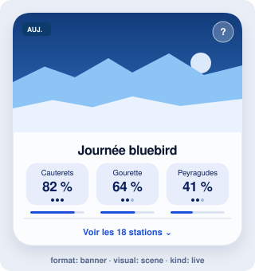
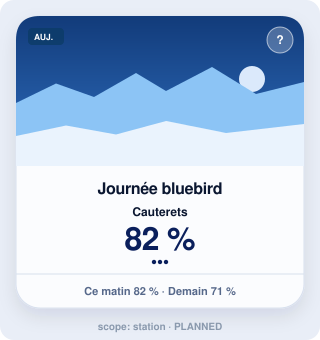
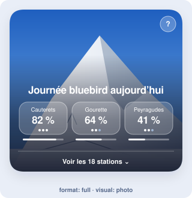
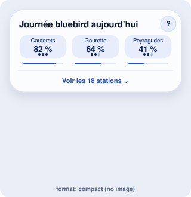
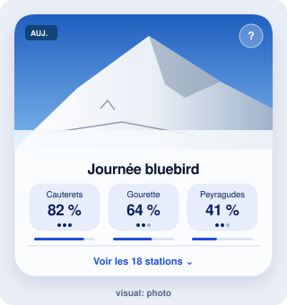
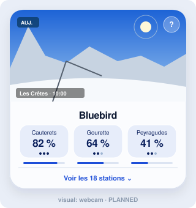
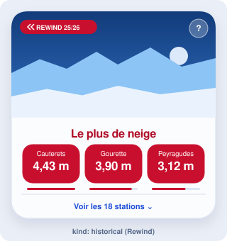
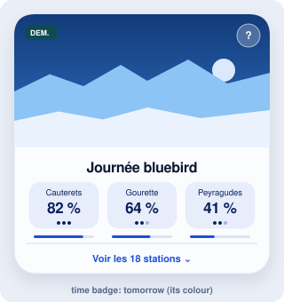
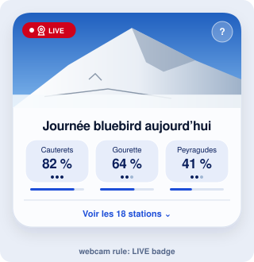
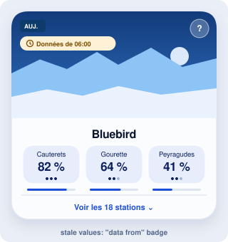

# TILES.md — how Bluebird tiles are classified

A **tile** is the card that shows one KPI on the site. Every tile is
described in [`config/tiles.yaml`](config/tiles.yaml) and classified on four
axes. Three are set on the tile, the fourth comes from its KPI:

| Axis | Key | Values | Set in |
|---|---|---|---|
| [Scope](#1-scope) | `scope` | `ranking` · `station` *(planned)* | `tiles.yaml` |
| [Format](#2-format) | `format` | `full` · `banner` · `compact` | `tiles.yaml` |
| [Visual](#3-visual) | `visual` | `scene` · `photo` · `webcam` *(planned)* | `tiles.yaml` |
| [Kind](#4-kind) | `kind` | `live` · `historical` | `kpis.yaml` (KPI) |

On top of the axes, a tile carries [corner badges](#5-corner-badges): the
time badge of live tiles ("Auj.", "Dem. | Matin", "Cette nuit": titles
never carry the period), then the LIVE webcam link (tile `webcam` rule), the Rewind badge or
the "data from" badge. Every tile follows the same [design rules](#9-design-nuit-étoilée)
(design "Nuit étoilée"): read them before adding an axis, a value or a format.

Every picture below is the same mockup with the same example data (the
bluebird day of a January morning in the Pyrenees: Cauterets 82 %, Gourette
64 %, Peyragudes 41 %), so two pictures differ only by the value they show.
The texts are the French UI, as on the site. The pictures are generated:
edit [`docs/tiles/render.mjs`](docs/tiles/render.mjs), then run
`node docs/tiles/render.mjs`; never edit the SVG files by hand.

> **Keep this file up to date.** Any change to tiles (an axis, a value, a
> format, an option, a badge, the design, a tile added, removed or changed
> in `config/tiles.yaml`) updates this file and, when the look changes, its
> pictures and §9, in the same task (AGENTS.md §1). `web/src/lib/tilesDoc.test.ts`
> fails when the [inventory](#7-inventory) no longer matches the config.

Vocabulary: **Tile** in code, configuration and documentation; the French
word *tuile* only appears in the French texts shown on the site.

---

## 1. Scope

How many stations the tile shows.

<table>
<tr>
<td width="50%"></td>
<td width="50%"></td>
</tr>
<tr>
<td valign="top">

**`ranking`** (default) — every station ranked on one KPI: the three best
as odds buttons, the others behind "Voir les 18 stations". Narrowed to the
place chosen in the massif bar.

</td>
<td valign="top">

**`station`** *(planned)* — one resort and its own value, for a future
station view. Not accepted by `bluebird validate` yet.

</td>
</tr>
</table>

## 2. Format

Size and layout. One Svelte component per format, registered in
[`web/src/tiles/registry.ts`](web/src/tiles/registry.ts) (`xyz` →
`TileXyz.svelte`).

<table>
<tr>
<td width="33%"></td>
<td width="33%"></td>
<td width="33%"></td>
</tr>
<tr>
<td valign="top">

**`full`** — `TileFull.svelte`. The image fills the whole collapsed card,
down to its bottom edge: title, odds and "see all" sit on it (the "live
match" card of betting apps). The full ranking opens below the image. Two
grid rows on wide screens.

</td>
<td valign="top">

**`banner`** — `TileBanner.svelte`. Image band on top, then title, odds
buttons and "see all". Two grid rows on wide screens.

</td>
<td valign="top">

**`compact`** — `TileCompact.svelte`. No image, half the height
(`--tile-compact-h`): two compact tiles stack beside one `banner` tile. A
badge row level with the "?" button (time badge, or Rewind / "data from"),
then the title. For the KPIs lower on the page.

</td>
</tr>
</table>

All formats share the same front parts (`OddsRow`, `RankingMore`), the same
back (`KpiBack`, turned with the "?" button) and the same sizes per format
(`--tile-*` tokens in `web/src/styles/base.css`).

## 3. Visual

The image of `full` and `banner` tiles. `compact` tiles have no image and
refuse `visual`.

<table>
<tr>
<td width="33%"></td>
<td width="33%"></td>
<td width="33%"></td>
</tr>
<tr>
<td valign="top">

**`scene`** (default) — an illustration (`BannerArt.svelte`), chosen by the
option `scene`: `snowfall`, `piste`, `offpiste`, `mountain` (default from
the icon), with the ridges of the massif `skyline`.

</td>
<td valign="top">

**`photo`** — a photo of the station ranked first, drawn once per page load
among `web/src/assets/photos/<massif>/<station>/` (Openverse, credited on
the back). No photo: the illustration.

</td>
<td valign="top">

**`webcam`** *(planned)* — the live image of the leading station's webcam,
today only. Needs the written agreement of the webcam's owner (README.md
"Roadmap"); until then the tile only links it ([LIVE badge](#5-corner-badges)).

</td>
</tr>
</table>

## 4. Kind

Not set on the tile: it comes from the `kind` of its KPI in
[`config/kpis.yaml`](config/kpis.yaml). Every format and visual works for
both kinds; only the data and the theme change.

<table>
<tr>
<td width="50%"></td>
<td width="50%"></td>
</tr>
<tr>
<td valign="top">

**`live`** — forecasts, refreshed every 6 hours. The tile is a template
expanded once per period; the title stays the same ("Journée bluebird") and
the [time badge](#5-corner-badges) names the period ("Auj.", "Dem. |
Matin"); the back of the tile repeats it with its exact date. Values are probabilities, amounts or Oui/Possible/Non, with
reliability dots.

</td>
<td valign="top">

**`historical`** — a closed season (Rewind), shown once, only under its
filter. Red theme of the Rewind's filter, "REWIND 25/26" badge, values in
the KPI unit (4,43 m), no reliability dots, odds or details.

</td>
</tr>
</table>

## 5. Corner badges

Stacked in the top left corner of the image of `full` and `banner` tiles,
one under the other: the time badge first, then LIVE, Rewind or "data from".
On `compact` tiles they share one row level with the "?" button, above the
title (the time badge, or the Rewind / "data from" badge; never LIVE).

<table>
<tr>
<td width="33%"></td>
<td width="33%"></td>
<td width="33%"></td>
</tr>
<tr>
<td valign="top">

**Time badge** — automatic on every live tile (`TimeBadge.svelte`, model
`TileTime` in `web/src/lib/periods.ts`). A small rectangular ticket (radius
5px, against the round pills), with short labels written for each language
(`config/periods.yaml`):

- day cell, in the dark colour of the day (`badge_days`: "Auj." / "Today" /
  "Hoy", "Dem." / "Tmrw" / "Mañana"), white text;
- moment cell, soft, in the colour of the period `tone` with its icon
  (`badge`: "Matin" / "AM" / "Mañ.", "Aprèm" / "PM" / "Tarde"…);
- a whole day shows the day alone ("Auj."); today's night (periods of tone
  `night`) shows `badge_tonight` alone, with a moon ("Cette nuit").

Tile titles never contain the period (`{period}` is refused by
`bluebird validate`); screen readers get it in words from a hidden part of
the title ("Journée bluebird aujourd'hui"), the badge itself is hidden from
them. The back of every live tile has a "Quand ?" section: the badge, the
period in words and its exact date ("Samedi 16 janvier, de 06:00 à 12:00").

</td>
<td valign="top">

**LIVE webcam link** — tile field `webcam`, live tiles only
(`WebcamBadge.svelte`, rule in `web/src/lib/webcams.ts`). A link to the
official page of the leading station's webcam (new tab), shown when:

- the period is today's and in progress (a webcam shows the present);
- the station ranked first has a webcam at one of `positions` (`summit`,
  `slopes`, `village`, `nordic`; `webcams` of
  `config/stations/<massif>.yaml`; first match wins);
- its probability reaches `min_probability` (default 0.6).

The webcam image is never shown or stored.

</td>
<td valign="top">

**Data from HH:MM** — automatic: the values come from an earlier refresh
because the KPI could not be recomputed (`StaleBadge.svelte`).

**REWIND 25/26** — automatic on historical tiles (`TileBadge.svelte`), see
[Kind](#4-kind). Rewind tiles have no time badge.

</td>
</tr>
</table>

## 6. Fields and options

```yaml
- id: bluebird_day                 # unique; DOM id <id>--<period>-<ski_day>
  scope: ranking                   # optional, default ranking
  format: banner                   # full | banner | compact
  visual: photo                    # optional, scene (default) | photo; not on compact
  webcam: { positions: [summit], min_probability: 0.6 }   # optional, live full/banner only
  kpis: [bluebird_day_chance]      # the tile shows the first KPI
  title: { fr: Journée bluebird, en: Bluebird day, es: Día bluebird }   # never the period
  icon: sun                        # optional, web/src/components/Icon.svelte
  periods: [day]                   # optional, live only; default: every period of the KPI
  options:                         # free-form, read by the components
    top: 3                         # odds buttons, 1–3 (default 3)
    show_odds: false               # decimal odds 1/p next to percentages
    details: false                 # tap a station for its details (off for now)
    scene: mountain                # illustration of the `scene` visual
    theme: default                 # default | rewind (overrides the theme)
```

Refused by `bluebird validate`: an unknown `format` or `scope`, `visual` or
`webcam` on a `compact` tile, `webcam` on a historical tile, an empty
`positions`, the old option `photo` (use `visual: photo`), `{period}` in a
title (the time badge shows the period).

The time badge reads `config/periods.yaml`: `badge_days` (one per day of
the horizon, with its day tone), `badge_tonight`, and per period a short
`badge` with its `tone` (none for the whole day).

## 7. Inventory

Every tile of `config/tiles.yaml`, in the order of `config/layout.yaml`
(`default`). Titles, filters and periods are in README.md "Tiles on the
site". Checked by `web/src/lib/tilesDoc.test.ts`.

| Tile | KPI | Scope | Format | Visual | Kind | Webcam |
|---|---|---|---|---|---|---|
| `snowfall_today` | `snowfall_chance` | ranking | full | photo | live | — |
| `onpiste_powder` | `onpiste_powder_chance` | ranking | banner | photo | live | — |
| `offpiste_powder` | `offpiste_powder_chance` | ranking | compact | — | live | — |
| `bluebird_day` | `bluebird_day_chance` | ranking | banner | photo | live | summit ≥ 60 % |
| `whiteout` | `whiteout_chance` | ranking | compact | — | live | — |
| `powder_alert` | `powder_alert_chance` | ranking | compact | — | live | — |
| `snowmaking` | `snowmaking_chance` | ranking | compact | — | live | — |
| `spring_snow` | `spring_snow_chance` | ranking | compact | — | live | — |
| `hard_snow` | `hard_snow_chance` | ranking | compact | — | live | — |
| `heavy_snow` | `heavy_snow_chance` | ranking | compact | — | live | — |
| `easy_conditions` | `easy_conditions_chance` | ranking | compact | — | live | — |
| `sunset` | `sunset_chance` | ranking | banner | photo | live | — |
| `starry_night` | `starry_night_chance` | ranking | compact | — | live | — |
| `sunny_slot` | `sunny_slot_chance` | ranking | compact | — | live | — |
| `wind_chill` | `wind_chill_chance` | ranking | compact | — | live | — |
| `mild_day` | `mild_day_chance` | ranking | compact | — | live | — |
| `chains` | `chains_chance` | ranking | compact | — | live | — |
| `lift_wind` | `lift_wind_chance` | ranking | compact | — | live | — |
| `wind_slab` | `wind_slab_chance` | ranking | compact | — | live | — |
| `rewind_2025_26_total_snowfall` | `season_total_snowfall` | ranking | full | photo | historical | — |
| `rewind_2025_26_longest_snowfall` | `season_longest_snowfall` | ranking | banner | photo | historical | — |
| `rewind_2025_26_domain_snowfall` | `season_domain_snowfall` | ranking | banner | photo | historical | — |
| `rewind_2025_26_offpiste_snowfall` | `season_offpiste_snowfall` | ranking | banner | photo | historical | — |
| `rewind_2025_26_deep_snow_days` | `season_deep_snow_days` | ranking | banner | photo | historical | — |
| `rewind_2025_26_white_days` | `season_white_days` | ranking | banner | photo | historical | — |

Totals: 25 tiles — 2 `full`, 8 `banner`, 15 `compact`; 19 live, 6 historical;
1 with a webcam rule.

## 8. Changing tiles

| Task | Where |
|---|---|
| Add or change a tile | `config/tiles.yaml`, `config/layout.yaml`, this file (§7), README.md "Tiles on the site" |
| Add a format | `TileFormat` in `pipeline/src/bluebird_pipeline/config.py`, `web/src/tiles/Tile<Xyz>.svelte`, `registry.ts`, this file (§2 + a picture in `render.mjs`) |
| Add a visual or a scope | the `Tile*` literal in `config.py`, the components, this file (§1/§3 + a picture) |
| Link a station webcam | `webcams` in `config/stations/<massif>.yaml`, tile `webcam` rule, this file (§5, §7) |
| Change what a tile shows (a badge, the odds, a back section) | the components, then the page "Lire une tuile" for users: `TileGuide.svelte` (example front and back with numbered marks) and the numbered paragraphs of the page `guide` in `config/pages.yaml` (`front-marks`, `back-marks`, same count as the marks) |
| Change the time badge | labels and `tone` of the periods in `config/periods.yaml`, colours `--when-*` / `--tone-*` / `--ticket-*` in `tokens.css`, `TimeBadge.svelte`, `TONE_ICONS` in `web/src/lib/periods.ts`, this file (§5, §9) |
| Change the look | `tokens.css` / `base.css` first, then the components, §9 of this file, and `render.mjs` so the pictures stay true |

After a change to `config.py`: `uv run bluebird schemas`, `npm run gen:types`.

## 9. Design: Nuit étoilée

The tile design since November 2026 (design n°12 of the exploration). Goal:
readable and sober, with Liquid Glass on surfaces and images only. A new axis,
value or format reuses these rules; it never brings its own colours, fonts or
sizes. Values below are the tokens of `web/src/styles/tokens.css` (palette,
fonts, radii) and `web/src/styles/base.css` (tile sizes, glass recipes).

### Principles

1. **Data first.** The three leading stations and their values are the
   biggest, most contrasted things on a tile; everything else is quieter.
2. **One accent.** Midnight blue for chosen states, electric blue for links
   and bars. Semantic colours (Rewind red, LIVE red, stale amber, service
   states) are separate and never decorative.
3. **Glass only where it adds depth**: cards, odds buttons, chips, and
   controls laid on an image. The page background stays plain, never a
   gradient or an animation (CONTEXT.md invariant 14).
4. **Same face, two weights.** Sora for everything: 700 with tight tracking
   for titles and values, 400–600 for text. The sport italic (Barlow Semi
   Condensed 800) is kept for the logo only.
5. **Equal sizes.** Every tile of a format has the same collapsed size, so the
   grid stays calm whatever the data.

### Palette (role tokens)

| Role | Token | Light | Dark |
|---|---|---|---|
| Page | `--bg` | `#e9eef7` | `#050b18` |
| Card surface (under the glass) | `--surface` | `#fbfcfe` | `#0b1530` |
| Lines, separators | `--line` | `#d8e0ee` | `#1a2850` |
| Text / soft / faint | `--ink` · `--ink-soft` · `--ink-faint` | `#0a1630` · `#3b4d70` · `#56688a` | `#e8eeff` · `#b7c4e0` · `#8fa0c4` |
| Chosen state (chips) | `--brand` / `--on-brand` | `#0a1f5c` / white | `#4f8cff` / `#04122a` |
| Links, "see all" | `--link` | `#1d4ed8` | `#8db4ff` |
| Odds buttons | `--pill-bg` · `--pill-ink` · `--pill-border` | `#e3ebfb` · `#0a1f5c` · `#cfdcf6` | `#13224a` · `#e8eeff` · `#1f3366` |
| Bars (graphics only) | `--prob-low` → `--prob-high`, `--track` | `#a9bde6` → `#1d4ed8`, `#dce4f2` | `#2a4a92` → `#4f8cff`, `#1a2850` |
| Glass edge / top highlight | `--glass-edge` · `--glass-hi` | white 75 % · white 90 % | white 14 % · white 16 % |
| Rewind | `--rewind-red` · `--rewind-ink` | `#c8102e` · `#b00d27` | `#c8102e` · `#ff8a98` |
| LIVE badge | `--live-bg` / `--on-live` | `#d0021b` / white | same |

**Day colours** (`--when-<tone>`, the day cell of the time badge): dark, with
white text (`--when-ink`), at 88 % over the card, or at 80 % with a blur on
an image.

| Day tone | Label (fr · en · es) | Light | Dark |
|---|---|---|---|
| `today` | Auj. · Today · Hoy | `#0b3b66` | `#1b5c99` |
| `tonight` | Cette nuit · Tonight · Esta noche | `#2e1a6b` | `#4a3699` |
| `tomorrow` | Dem. · Tmrw · Mañana | `#0f4c45` | `#17706a` |
| planned: week-end, next week | Week-end · Sem. proch. | bronze, slate | — |

**Moment colours** (`--tone-<tone>-*`, the moment cell): one hue per moment
of the ski day, like the lenses of the logo, always soft: `-bg` at 24 % over
the card with `-text`, or at 42 % over `--ticket-glass` (dark glass) on an
image with white text and a `-vivid` icon. The same style every day: the day
colour tells today from tomorrow.

| Tone | Periods | `-bg` | `-text` light · dark | `-vivid` |
|---|---|---|---|---|
| `morning` | morning | `#f9a8d4` | `#be185d` · `#f9a8d4` | `#f9a8d4` |
| `midday` | midday | `#fde047` | `#854d0e` · `#fde047` | `#fde047` |
| `afternoon` | afternoon | `#f59e0b` | `#92400e` · `#fbbf24` | `#fbbf24` |
| `evening` | evening, sunset | `#7c3aed` | `#6d28d9` · `#c4b5fd` | `#c4b5fd` |
| `night` | night, overnight (tomorrow; today: "Cette nuit") | `#1e1b4b` (dark `#3730a3`) | `#3730a3` · `#a5b4fc` | `#a5b4fc` |

These colours never appear elsewhere: none is red (Rewind, LIVE) or amber
alone on text (stale).

Text pairs keep at least 4.5:1; `--prob-*` and `--sky` are for bars and
marks only, never text.

### Typography

Sora Variable, self-hosted (`@fontsource-variable/sora`, `--font-sans`,
`--font-display`). Titles and values use `--display-weight` (700) and
`--display-tracking` (−0.02em).

| Element | Size | Weight | Notes |
|---|---|---|---|
| Tile title, `full` and `banner` | 1.5rem | 700 | long titles (> 24 chars) 1.25rem, two lines max; never the period |
| Tile title, `compact` | 1.375rem | 700 | long titles (> 20 chars) 1.125rem, one line, ellipsis |
| Odds value | 1.5rem | 700 | `compact`: 1.1875rem; unit at the same size |
| Station name in an odds button | 0.75rem | 600 | two lines max (`compact`: 0.6875rem, one line) |
| "See all" / "see less" | 0.875rem | 700 | `--link`, white on an image |
| Ranking row: rank, name / value pill | 0.9375rem / 1.1875rem | 700, 600 / 700 | pill unit 0.6875rem |
| Corner badge | 0.6875rem | 800 | uppercase, 0.1em tracking |
| Time badge | 0.625rem | 700 | uppercase, 0.06em tracking, icon 12px; label line-height 1.4 so accents (MAÑ., APRÈM) are not clipped |
| Data date (above the tiles) | 1.625rem | 700 | sub-line 0.8125rem |
| Chips of the bars | 0.8125rem | 600 | |
| Tile back: title / text / section labels | 1.625rem / 0.875rem / 0.6875rem | 700 / 400 / 800 | labels uppercase; reliability level 1.375rem |

### Shapes and sizes

| What | Token / value |
|---|---|
| Card radius | `--radius-l` 24px |
| Odds buttons, inner boxes | `--radius-m` 16px |
| Chips, badges, pills | 999px |
| Time badge | 5px, height 1.375rem, cells padded 6px (rectangular on purpose) |
| Image band of `banner` | `--tile-banner-h` 13rem |
| Front of `full` / `banner` (image + title + odds) | `--tile-front-h` 23rem (title + odds of `banner`: 160px) |
| "See all" bar | `--tile-more-h` 2.875rem |
| Gap between tiles | `--tile-gap` 18px |
| Front of `compact` | `--tile-compact-h` = (front − more − frame − gap) / 2 = 151px: badge row (17px from the top, centred on "?"), title, odds |
| Card frame | `--tile-frame-h` 2px (top and bottom borders) |
| Odds button | `--odds-button-h` 5.25rem (`compact`: 3.625rem) |
| Inner padding | 14px |
| Corner badge slot | top 17px (time badge centred on "?"), left 12px, right 56px (clear of "?"); badges stacked, 6px apart |
| "?" / "×" button | 2.25rem round, top and right 10px |

Two `compact` tiles plus one gap equal one `full` / `banner` tile (2 × 199
+ 18 = 416px with the "see all" bar and the frame): on wide screens `full`
and `banner` span two grid rows (`tileRows`).

### Surfaces (glass recipes)

| Surface | Recipe |
|---|---|
| Card (`.card-body`) | `--card-bg` (surface at 78 %), 1px `--glass-edge`, `inset 0 1px 0 --glass-hi` + `--shadow`, `backdrop-filter: blur(20px) saturate(1.6)` |
| Odds button | `--pill-bg` at `--odds-glass` (62 %), 1px `--glass-edge`, inset highlight, blur 12px |
| Odds button on an image | `--odds-overlay-bg` (white 18 %), `--odds-overlay-edge` (white 42 %), white text; reliability dots in the text colour (filled 100 %, empty 35 %), never `--prob-high` on a photo |
| Chip | surface at 75 %, 1px `--line`, inset highlight; chosen: `--brand`, no glass |
| "?" on an image | white 20 %, white 50 % edge, blur 10px; on the card: `--pill-bg` |

Every glass surface falls back to its opaque colour with
`prefers-reduced-transparency: reduce` and without `backdrop-filter`.
A theme may make the buttons solid: the Rewind theme sets `--odds-glass:
100%` and red overlay tokens (`[data-tile-theme='rewind']` in `base.css`).

### Images

- `banner`: the image is a 13rem band at the top of the card.
- `full`: the image covers the whole collapsed card, down to the bottom edge,
  under the "see all" bar; a shade (transparent at the top, 88 % midnight at
  the bottom) keeps white text legible. The ranking opens below the image.
- White text and white glass appear only on an image with its shade; marks
  laid on an image (reliability dots, bars) are white too.
- Photos (`visual: photo`) are free-licence pictures of the leading station;
  without one, the illustration (`BannerArt`, colours `--banner-*`).

### Motion and states

- Turning a card: 0.55s with a symmetric easing; the faces swap at mid-turn
  (card edge-on), so text is never seen reversed; none with
  `prefers-reduced-motion`.
- Tiles arrive and leave with the `arrive` / `leave` transitions; nothing else
  moves, and never the page background. Planned: tile effects, a layer
  between the background and the text, permanent (falling snow) or flash
  (a sun glint, once per view), always inside the tile and off with reduced
  motion (README.md "Roadmap").
- Chosen odds button: `--pill-active-bg` / `--pill-active-ink`, solid.
- Focus: 3px `--focus` ring, 2px offset.

### Checklist for a new axis, value or format

- [ ] Colours only from role tokens; a new colour is a new role token with a
      light and a dark value, in this table.
- [ ] Text sizes from the typography table; a new element gets a row here.
- [ ] One of the existing tile sizes, or a new `--tile-*` token shared by
      every tile of the new format, keeping the two-compacts-per-banner rule.
- [ ] Surfaces from the glass recipes, with their opaque fallback.
- [ ] Image rules above; badges in the corner slot (on `compact`: the badge
      row), the time badge first on every live tile.
- [ ] Works in the Rewind theme (through tokens, no kind-specific CSS).
- [ ] The page "Lire une tuile" (`TileGuide.svelte`, page `guide`) still
      matches the tile.
- [ ] Checked at 390 px, light and dark, French, English and Spanish.
- [ ] A picture in `docs/tiles/render.mjs`, and §1–§5 and §7 of this file.
