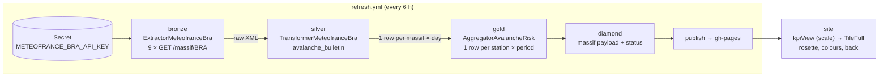
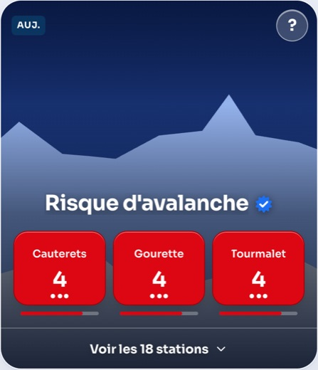
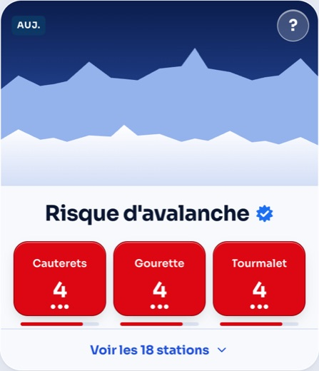
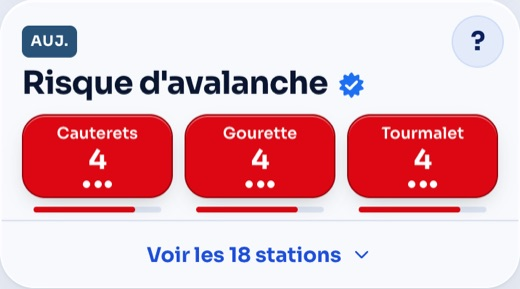
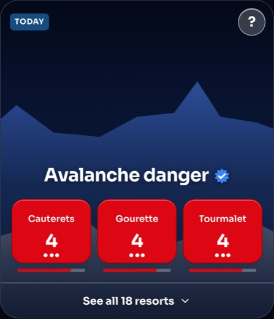
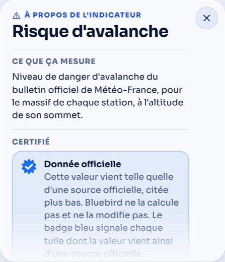
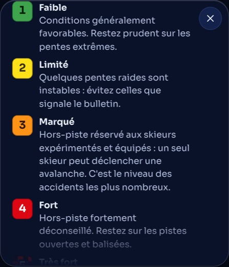
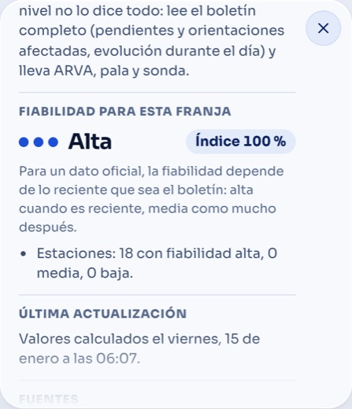

# KPI `avalanche_risk` — Avalanche danger

> Risque d'avalanche · Avalanche danger · Peligro de aludes

The avalanche danger level (1 to 5, European scale) of the official
Météo-France avalanche bulletin (BRA), for the avalanche massif of each
resort, at the elevation of its summit. Bluebird **relays** the level, it
never computes or changes it: the tile carries a blue "certified" rosette.

This page follows the data from the source to the screen. For the rules that
apply to every KPI, see [CONTEXT.md](../../../CONTEXT.md); for the tile axes,
[TILES.md](../../../TILES.md).

## At a glance

| | |
|---|---|
| Kind | `live`, refreshed every 6 hours (00:00, 06:00, 12:00, 18:00 Paris), November to May |
| Category / filter | Safety (Sécurité) → group Off-piste; Mood → Sur place → Freerider |
| Periods | `day` only (today, tomorrow), whole day |
| Display | `scale`: the level as a number on its European colour; `certified: true` |
| Tile | `avalanche_risk`, format `full`, visual `scene` (`mountain`), icon `alert`, top 3 |
| Home page | priority 0.9, shown from level 3, full strength at 4, **alert from 4** |
| Source | Météo-France API *DonneesPubliquesBRA*, one request per avalanche massif (9 for the Pyrenees) |
| Secret | `METEOFRANCE_BRA_API_KEY` (GitHub secret, key of type *API Key*, valid one year) |
| Licence | Licence Ouverte Etalab 2.0, attribution "Météo-France" |

## The data journey



### 0. Configuration (hand-written)

| File | What it holds for this KPI |
|---|---|
| `config/stations/pyrenees.yaml` | `avalanche_massif` of each resort: the Météo-France massif number (64 Pays-Basque … 73 Capcir Puymorens). Checked against the official massif outlines (`metadata_massifs.geojson`, data.gouv.fr) with a point-in-polygon test. |
| `config/sources.yaml` | Source `meteofrance_bra` (`schedule: daily`, `min_interval_s: 1.5`, `timeout_s: 30`, attribution). |
| `config/kpis.yaml` | KPI `avalanche_risk`: name, description, `method` (shown on the back, `{fresh_hours}` filled in), `params.fresh_hours: 24`, `display: scale` with the five `steps` (tone, label, advice), `certified: true`, `official_link` (the official bulletins page, linked from the back), `visibility`, drivers. |
| `config/tiles.yaml`, `config/layout.yaml`, `config/filters.yaml` | The tile, its place in the layout (after *Lifts in the wind*, before *Wind-blown snow*), its filter group and mood. |

### 1. The key and the schedule

- `refresh.yml` runs four times a day. The `plan` job lists the enabled
  daily sources; `meteofrance_bra` gets its own bronze job.
- That job, and only that one, receives the secret:
  `METEOFRANCE_BRA_API_KEY: ${{ matrix.source == 'meteofrance_bra' && secrets.… || '' }}`.
- Locally: `export METEOFRANCE_BRA_API_KEY=…` then
  `uv run bluebird run --layer bronze --source meteofrance_bra`.

### 2. Bronze — fetch the raw bulletins

`pipeline/src/bluebird_pipeline/bronze/extractor_meteofrance_bra.py`

- Lists the distinct `avalanche_massif` of the enabled stations, then sends
  for each: `GET https://public-api.meteofrance.fr/public/DPBRA/v1/massif/BRA?id-massif=66&format=xml`
  with the header `apikey: <key>`.
- Stores each answer **as is** (the XML text) in a `BronzeRecord`
  (`context.massif_number`), all of them in one batch:
  `bronze/meteofrance_bra/{date}/{run_id}.json.gz` (a 7-day workflow
  artifact in CI). The key is never written in a record.

| Answer | What happens |
|---|---|
| 200 with a bulletin | Record with the XML. |
| 404, 204 or empty body (no bulletin: out of season) | Record with a null payload: **not an error**. |
| 401 / 403 | The source fails at once: "Météo-France refused the API key … check METEOFRANCE_BRA_API_KEY". |
| 5xx, network error | Retried (base extractor), then that massif is skipped; the source fails only if every massif failed. |
| 429 | Waited out (`Retry-After` or 65 s). |

### 3. Silver — read the XML

`silver/transformer_meteofrance_bra.py` (`parse_bulletin`), contract in
`silver/_avalanche.py`. Field reference: Météo-France, *Descriptif technique
des informations du bulletin avalanche* (data.gouv.fr).

| XML | Meaning | Column |
|---|---|---|
| `ID`, `MASSIF` (root) | Massif number and name | `massif_number`, `massif_name` |
| `DATEBULLETIN` | When the bulletin was written, **in UTC** (16:00 Paris = 15:00 UTC in winter) | `issued_at` |
| `DATEVALIDITE` | End of validity, the day after at 18:00 UTC | `valid_date` (local day) |
| `RISQUE1` / `EVOLURISQUE1` | Level (lower band when split) / its level later in the day | `level_low` |
| `RISQUE2` / `EVOLURISQUE2` | Upper band (or the other side of the massif) | `level_high` |
| `ALTITUDE`, `LOC1`, `LOC2` | Limit of an elevation split (`<2100` / `>2100`), or a geographic split (`E`/`O`, `S`/`N`) | `altitude_limit_m` |
| `RISQUEMAXIJ2`, `DATE_RISQUE_J2` | Maximum level forecast for the day after | a second row, `trend = true` |

Rules applied, in order:

1. A band's level is the **higher** of `RISQUEn` and `EVOLURISQUEn`.
2. No `RISQUE2`: one level everywhere (`level_low = level_high`, no limit).
3. `RISQUE2` with an `ALTITUDE`: elevation split, `RISQUE1` below, `RISQUE2`
   above (swapped if `LOC1` ever starts with `>`).
4. `RISQUE2` without `ALTITUDE`: geographic split. The side of a resort is
   unknown, so both columns take the **higher** level (also vs `RISQUEMAXI`).
5. The day-after trend becomes a row of its own (`trend = true`, max level
   only, no limit).
6. Records without payload are skipped; invalid XML is logged and skipped.
   Out of season the table is empty, which is fine.

Example, the real bulletin of Haute-Bigorre issued on 2026-11-07
(`pipeline/tests/silver/fixtures/meteofrance_bra_66.xml`):

| massif | valid_date | low | high | limit | trend | issued_at (UTC) |
|---|---|---|---|---|---|---|
| 66 Haute-Bigorre | 2026-11-08 | 1 | 1 | — | false | 2026-11-07 15:00 |
| 66 Haute-Bigorre | 2026-11-09 | 1 | 1 | — | true | 2026-11-07 15:00 |

### 4. Gold — one value per resort and period

`gold/aggregator_avalanche_risk.py`, stored in
`gold/kpis/date={ski_day}/avalanche_risk.parquet`.

For each resort and each visible `day` period (today, tomorrow):

1. Rows of the resort's massif valid on that day.
2. A real bulletin **beats** a trend; then the latest `issued_at` wins
   (an amended bulletin replaces the first one).
3. Level at the summit: `level_high` if the summit is at or above
   `altitude_limit_m` (or there is no limit), else `level_low`.
4. `probability = (level − 1) / 4` (0 to 1): it only orders the ranking,
   highest danger first. `members = 0` (no scenarios).
5. Reliability: **high** up to `fresh_hours` (24 h) after `issued_at`,
   **medium** after that, and always medium for a trend.
6. Drivers published: `level`, `level_low`, `level_high`,
   `altitude_limit_m`, `summit_m`, `massif`, `issued_at`.

No row at all (out of season): the KPI is reported `ok`, not `down`
(`empty_ok` on the aggregator, read by `runner.run_gold_kpi` and
`diamond/_status.py`). A missing silver table (the source failed) still fails
it, and the values of the previous run are kept for periods still to come
and shown with the "data from HH:MM" badge.

### 5. Diamond and publication

- `DisplayerMassifDaily` puts the ranking of each period in
  `diamond/pyrenees/latest.json` like any other KPI (values, drivers,
  confidence). `bluebird status` writes `diamond/status.json`.
- The `publish` job commits gold, diamond and status to `gh-pages/data/`.

### 6. On the site

| Step | Code |
|---|---|
| The tile template is expanded per period (today, tomorrow) | `lib/periods.ts` (`expandTiles`) |
| `liveView` reads the `scale` display: value = driver `level`, bar = level / 5, `step` = its tone | `lib/kpiView.ts` (`stepOf`, `scaleMax`) |
| Odds buttons and pills take the colour of the level (`data-scale`), level 5 a red and black checkerboard with an outlined number | `OddsRow.svelte`, `ValuePill.svelte`, `styles/base.css`, tokens `--danger-*` |
| Rosette after the title (`certified`) | `CertifiedBadge.svelte` in `TileFull` / `TileBanner` / `TileCompact` |
| Back: "Certifié" box with the link to the official bulletin (new tab), "Que faire selon le niveau ?" (the five steps and their advice), reliability text about the bulletin's freshness (no scenarios line) | `KpiBack.svelte`, strings `back.certified*`, `back.scale`, `back.reliabilityHelpOfficial`, `back.newTab` |
| Screen readers: "1. Gourette, niveau 4 sur 5, fort" | `tiles/summary.ts` (`a11y.scale`) |
| Home page: level of the top 3 of the place vs floor 3 / strong 4; level ≥ 4 is an alert, shown right after the bluebird day | `lib/homeFeed.ts`, `visibility` in `kpis.yaml` |

## What the visitor sees during a day

| Refresh | Today | Tomorrow |
|---|---|---|
| 00:00, 06:00, 12:00 | Bulletin issued yesterday at 16:00 (high reliability until 16:00 today, then medium) | The trend of that bulletin (medium) |
| 18:00 | Same bulletin (medium, older than 24 h) | Bulletin issued today at 16:00 (high) |
| Out of season | No avalanche tile, status OK | No avalanche tile |

## Visuals

Screenshots at 390 px (demo data, level 4 on the Atlantic side). The
generated mockups of this display (levels 5, 4, 3, rosette) are in
[TILES.md §4](../../../TILES.md#values-on-an-official-scale-and-certified-kpis).

### Tiles that can show this KPI, by size

✅ used today (`config/tiles.yaml`) · ☑️ possible: change `format` of the
tile · a format shown in grey and struck through cannot show this KPI.
**None is excluded today**: the `scale` display, its colours and the
certified rosette are generic, so every format renders them (checked with
temporary banner and compact tiles, titles not cut).

**Large — 416 px high** (`--tile-front-h` + "see all" bar; two grid rows on
wide screens)

| ✅ `full` — image fills the card | ☑️ `banner` — image band on top |
|---|---|
|  |  |
| `visual: scene` (`mountain`) today; `visual: photo` possible (photo of the leading resort) | `scene` or `photo`, same size as `full` |

**Half — 199 px high** (`--tile-compact-h`: two compact tiles stack beside
one large tile)

| ☑️ `compact` — no image |
|---|
|  |
| No `visual` and no `webcam` rule (refused by `bluebird validate`); rosette 20 px |

### Front and back

| Front (fr, light) | Front (en, dark) | Back, top (fr, light) |
|---|---|---|
|  |  |  |

| Official data box and link (fr, dark) | What to do at each level (fr, dark) | Reliability (es, light) |
|---|---|---|
|  |  |  |

## Failures and edge cases

| Situation | Result |
|---|---|
| Key missing or expired | Bronze `down` with a clear message; previous values kept (stale badge) for periods still to come; other tiles unaffected. Renew the key on the portal, update the secret. |
| One massif fails (5xx) | Its resorts get no fresh value (kept from the last run if any); the other massifs are fine. |
| Bulletin amended later in the day | The latest `issued_at` wins at the next refresh. |
| Resort outside every French massif (Spain, Andorra) | No `avalanche_massif`: no value for it. |
| Resort near a massif edge | Uses the polygon it lies in; check new resorts with the outlines. |

## Run and test

```bash
cd pipeline
uv run pytest tests/bronze/test_extractor_meteofrance_bra.py \
  tests/silver/test_transformer_meteofrance_bra.py tests/gold/test_avalanche_risk.py
export METEOFRANCE_BRA_API_KEY=…          # real call, local only
uv run bluebird run --source meteofrance_bra --kpi avalanche_risk
uv run bluebird demo                      # synthetic bulletins (demo.py), no key needed
```

## Limits

- The level does not tell everything: the full bulletin also gives the
  slopes and aspects concerned, how the danger changes during the day and
  the snowpack. The back links to it and says so.
- One level per resort, at its summit; a resort spanning the altitude limit
  has slopes at both levels.
- Bluebird is a planning aid, never a replacement for the bulletin.

## Code map

| Layer | File |
|---|---|
| Config models | `pipeline/src/bluebird_pipeline/config.py` (`Station.avalanche_massif`, `KpiDisplay` `scale`, `ScaleStep`, `Kpi.certified`, `OfficialLink`) |
| Bronze | `bronze/extractor_meteofrance_bra.py` |
| Silver | `silver/transformer_meteofrance_bra.py`, `silver/_avalanche.py` |
| Gold | `gold/aggregator_avalanche_risk.py`, `gold/base.py` (`empty_ok`, `result(confidence=…)`) |
| Status | `runner.py` (`run_gold_kpi`), `diamond/_status.py` |
| Demo | `demo.py` (`demo_bulletins`) |
| Site | `web/src/lib/kpiView.ts`, `web/src/tiles/KpiBack.svelte`, `TileFull.svelte`, `OddsRow.svelte`, `StationRow.svelte`, `web/src/components/CertifiedBadge.svelte`, `ValuePill.svelte`, `web/src/styles/tokens.css`, `base.css` |
| Tests | `pipeline/tests/bronze/test_extractor_meteofrance_bra.py`, `tests/silver/test_transformer_meteofrance_bra.py` (+ `fixtures/meteofrance_bra_66.xml`), `tests/gold/test_avalanche_risk.py` |
| CI | `.github/workflows/refresh.yml` (secret on the bronze job of this source) |
